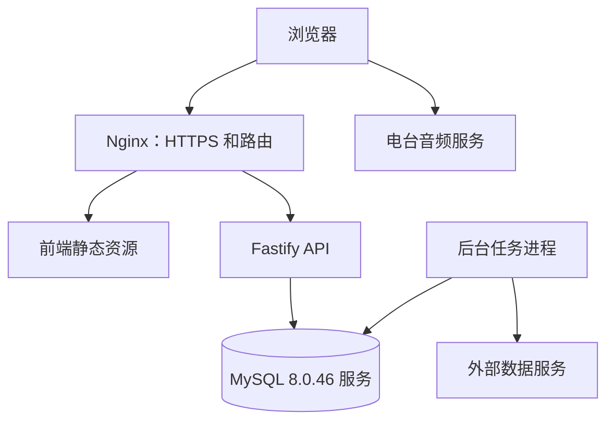

# 系统设计

状态：服务和运行配置已实现，正式部署状态见[记录](../iterations/2026-10-17-production-deployment/README.md)。

## 代码、构建与运行关系

| 层面 | 约定 |
| --- | --- |
| 代码仓库 | 同一个仓库，pnpm Workspace |
| 本地开发 | 前端开发服务器、API、后台任务独立启动 |
| 构建产物 | 前端静态资源、后端 JavaScript 分别构建 |
| 生产运行 | 共享 Nginx 读取静态文件，API、后台任务各一个容器 |
| 发布 | Jenkins 默认协调一起发布，允许兼容范围内单独更新 |
| 用户访问 | 同一域名；`/radio/` 页面与 `/radio/api/*` 分流 |

前端由现有 Nginx 直接提供已发布的静态文件，不运行独立 Web 容器。决定见 [ADR-0006](decisions/0006-shared-nginx-static-release.md)。

## 访问路径

同域路由统一处理前端和 API。反向代理保留 `/api/v1` 前缀，API 自身也注册相同前缀，避免开发与生产路径不一致。本地使用 Vite 代理模拟同域访问。

## 职责边界

- React 负责 DOM 界面和交互状态。
- Three.js 场景负责图形资源、帧循环与渲染。
- 音频引擎负责播放生命周期，通过事件报告状态。
- Fastify 负责 API、契约校验、数据访问和外部服务适配。
- 后台任务负责批处理与调度，不占用 API 的长请求连接。
- 可选账号登录使用服务端密码派生与 HttpOnly Cookie 会话；账号收藏和历史由带用户边界及版本校验的接口同步，未登录数据保持本机独立，详见[账号同步](../iterations/2026-10-23-account-sync/README.md)。
- MySQL 保存服务端持久数据，后端通过 mysql2 连接池和 Drizzle ORM 访问；浏览器存储保存本地偏好与缓存。

## 音频流量

后端向浏览器返回经过校验的播放信息，浏览器直接请求电台音频。持续收听的音频流量默认不经过本项目服务器。

用户所在网络、上游服务、编码、HTTPS 和跨域设置共同决定可播放能力。服务端可连接不代表用户一定能播放。代理或转码属于另行评估的能力，需要重新核算带宽、运行时和访问边界。

## 部署边界

应用基线为一台 Linux 服务器，API 一个实例、任务进程一个实例。当前数据库目标是已提供的现有 MySQL 8.0.46 实例，连接信息私有保存；应用将通过各自的 mysql2 连接池访问。开发与正式库名已指定，但检查时尚未创建，应用连接待验收。

数据库数据由 MySQL 服务管理；API 与任务不挂载数据库文件。自管 MySQL 使用持久卷，现有服务遵循其存储和备份策略。迁移在发布中的独立阶段串行执行，不与其他迁移或应用写入并发。应用横向扩容前重新评估连接总量和任务协调方案。

容器关系见[容器与存储](../deployment/containers/topology-and-storage.md)，音频边界见[音频引擎](../frontend/audio/audio-engine.md)。

## Android 客户端扩展（待实现）

2026-10-23 建立 `apps/android` 开发入口，技术路线采用 Kotlin/Compose 原生界面、Media3 原生播放与优先验证的局部 WebView 图形复用。此节是待实施的客户端扩展，不代表上文生产拓扑中已有 Android 应用或新服务。

- 原生客户端通过现有 HTTPS 网关请求 Fastify API，默认直连电台流；不访问 MySQL，不增加服务器音频代理。
- MediaSessionService 持有唯一播放器与后台策略，Compose 使用 MediaController 操作；网页图形仅接收快照并上报点选等事件。
- 图形资源随客户端打包，消息桥限制来源和载荷；账号 Cookie 仅供第一方原生 API 客户端，不进入图形、图片或音频请求。
- Room 保存本地集合与待同步操作，DataStore 保存设置；账号同步遵循现有用户与版本边界，不假设存在新的 Token 接口。
- Android 使用独立 Gradle 构建和安装包分发，现有 Web/API/任务发布流程保持当前边界。

选型依据见 [ADR-0007](decisions/0007-android-native-client.md)，工具链、接口、生命周期和验收细则见 [Android 技术方案](../android/technical-design.md)。
