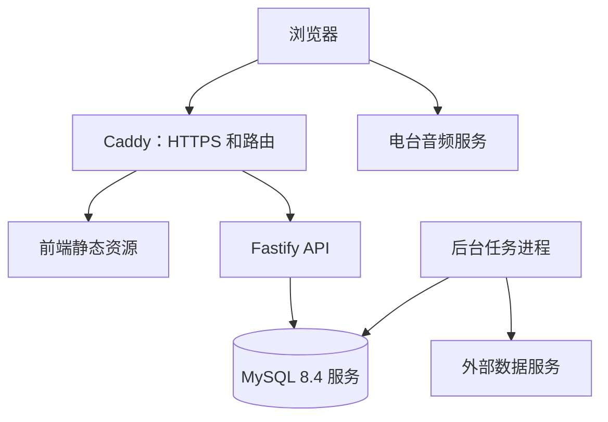

# 系统设计

状态：架构已确定，服务和运行配置待实施。

## 代码、构建与运行关系

| 层面 | 约定 |
| --- | --- |
| 代码仓库 | 同一个仓库，pnpm Workspace |
| 本地开发 | 前端开发服务器、API、后台任务独立启动 |
| 构建产物 | 前端静态资源、后端 JavaScript 分别构建 |
| 生产运行 | Web 入口、API、后台任务分别运行 |
| 发布 | Jenkins 默认协调一起发布，允许兼容范围内单独更新 |
| 用户访问 | 同一域名；前端页面与 `/api/*` 分流 |

前端独立运行的含义是由 Caddy 提供静态资源，不要求为前端启动一个 Node.js 服务。

## 访问路径

同域路由统一处理前端和 API。反向代理保留 `/api/v1` 前缀，API 自身也注册相同前缀，避免开发与生产路径不一致。本地使用 Vite 代理模拟同域访问。

## 职责边界

- React 负责 DOM 界面和交互状态。
- Three.js 场景负责图形资源、帧循环与渲染。
- 音频引擎负责播放生命周期，通过事件报告状态。
- Fastify 负责 API、契约校验、数据访问和外部服务适配。
- 后台任务负责批处理与调度，不占用 API 的长请求连接。
- MySQL 保存服务端持久数据，后端通过 mysql2 连接池和 Drizzle ORM 访问；浏览器存储保存本地偏好与缓存。

## 音频流量

后端向浏览器返回经过校验的播放信息，浏览器直接请求电台音频。持续收听的音频流量默认不经过本项目服务器。

用户所在网络、上游服务、编码、HTTPS 和跨域设置共同决定可播放能力。服务端可连接不代表用户一定能播放。代理或转码属于另行评估的能力，需要重新核算带宽、运行时和访问边界。

## 部署边界

应用基线为一台 Linux 服务器，API 一个实例、任务进程一个实例，通过各自的 mysql2 连接池访问同一个 MySQL 8.4 数据库。数据库可以是现有服务或独立容器，具体目标尚未确认。

数据库数据由 MySQL 服务管理；API 与任务不挂载数据库文件。自管 MySQL 使用持久卷，现有服务遵循其存储和备份策略。迁移在发布中的独立阶段串行执行，不与其他迁移或应用写入并发。应用横向扩容前重新评估连接总量和任务协调方案。

容器关系见[容器与存储](../deployment/containers/topology-and-storage.md)，音频边界见[音频引擎](../frontend/audio/audio-engine.md)。
