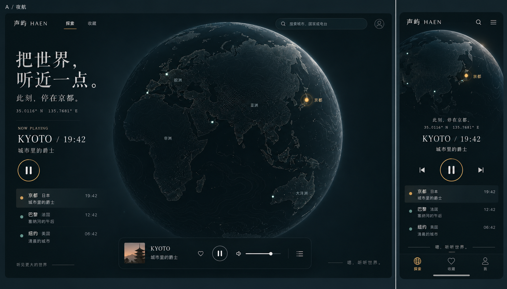

# 夜航设计规范

状态：2026-10-16 已由用户确认视觉方向。阶段 3 已实现基础列表与播放器并完成本阶段双端检查；指定字体资源和地球场景仍待接入，本文继续约束后续界面。

## 1. 视觉基准与适用范围

项目名称：声屿 HAEN。品牌标语：嗯，听听世界。

已确认的「夜航」以深海底色、立体地球和少量琥珀光点形成安静、沉浸的听觉探索体验。地球承担主要视觉表达，界面保持克制，不让装饰与播放操作争夺注意力。

- 本规范适用于后续页面、列表、搜索、弹层、播放器及其状态展示；具体功能范围由另行确认的功能规格决定。
- 概念图是视觉基准，不是整页背景素材。真实文字、控件和可交互场景分别实现，不能以图片覆盖页面代替界面。
- 图中的京都、电台名称、坐标、时刻、头像及上下曲等控件均为示意，不据此添加账号系统、曲目切换或其他功能，也不能作为真实业务数据。
- 图中的地理细节、文字及图标可能存在生成误差。实现时使用经核验的地理数据、语言资源与统一图标，文字规范、真实状态和可访问性优先于图片细节。
- 文字规则约束实现，概念图约束整体气质与视觉层次。需要改变主配色、字体角色或核心构图时，先重新确认概念图，再更新规则。

## 2. 颜色与设计变量

以下数值是对已确认风格的工程化约定，不宣称为图片逐像素取色结果。初始化前端时集中定义 CSS Variables，组件通过语义变量使用，不在各页面另配主题。

| 变量 | 基准值 | 用途 |
| --- | --- | --- |
| `--color-bg` | `#0B151B` | 页面深海背景 |
| `--color-surface` | `#15252D` | 播放器、浮层与输入区域 |
| `--color-text` | `#E8E9E1` | 标题、正文与主要操作 |
| `--color-text-muted` | `#A6B7B8` | 次要说明与坐标 |
| `--color-secondary` | `#83AAA3` | 辅助地理点与次级标识 |
| `--color-accent` | `#D8AD6B` | 当前电台、播放主操作及焦点强调 |
| `--color-on-accent` | `#0B151B` | 琥珀实心底上的文字与图标 |
| `--color-border` | `rgba(166, 183, 184, 0.18)` | 装饰分隔线与弱边框 |
| `--color-selected-bg` | `rgba(131, 170, 163, 0.12)` | 当前行的轻量背景 |

- 暖白是主要文字颜色，青灰为辅助，琥珀只用于少量重要位置；不得把整片背景或所有按钮都染成金色。
- 弱边框仅作装饰。输入框、可操作边界和焦点环不能仅靠弱边框识别，使用足够对比的描边、文字或形状。
- 错误、警告等语义状态须有文字与图标，后续根据实际状态补充语义变量，并核对暗色背景上的对比度；不能以琥珀同时表达所有状态。
- 不使用紫蓝渐变、大面积霓虹、强反射金属、重毛玻璃或高饱和多色光晕。

## 3. 字体、尺寸与组件质感

| 角色 | 字体方向 | 基准 |
| --- | --- | --- |
| 品牌与短标题 | `Noto Serif SC`、衬线回退字体 | 品牌 20–24px；展示标题桌面 48–64px、手机 28–36px，行高 1.2–1.35 |
| 界面与正文 | `Noto Sans SC`、系统无衬线回退字体 | 正文 16px、行高 1.5–1.7；导航与列表辅助信息 14px |
| 坐标、时刻与短标识 | `IBM Plex Mono`、系统等宽回退字体 | 12–14px，克制增加字距 |

- 字体为后续资源选用基准，目前尚未接入产品。接入前核对使用许可、中文字形覆盖和字重，按所需资源本地分发；保留系统回退以应对加载失败。
- 衬线字形用于品牌和短标题，避免把整页操作文字都变成衬线。桌面短标题左对齐，手机以当前电台为中心组织信息。
- 以 `4 / 8 / 12 / 16 / 24 / 32 / 48 / 64px` 建立间距层级。普通列表行至少 56px；触屏操作目标至少 44×44px，相邻目标保持足够间距。
- 面板圆角 12–16px，选中行 6–8px；主播放按钮为圆形，搜索框可使用胶囊形。不把每一条信息都包成独立卡片。
- 使用 Lucide 线性图标，常用尺寸 20–24px、统一线宽。图标按钮必须具备可访问名称，重要操作保留可见说明。
- 面板通过微弱的底色差和细描边分层，阴影与透明效果保持轻量；列表使用留白与弱分隔形成秩序。

## 4. 双端构图

### 电脑端：信息与地球的非对称构图

- 以 1440×900 为主要验收视口。顶栏放品牌、已确认的导航及搜索；页面边距约 32–48px，信息区左对齐。
- 左侧信息区约占内容宽度的 24%–30%，展示短标题、地点、电台与必要操作。地球占据中右区域，形成主要视觉重心，不能挤压文字和控件。
- 地球可在场景容器内局部裁切以增强空间感；DOM 内容不得被画布覆盖。主操作区始终保持清楚、可点击。
- 播放器使用底部深色横向面板，内容紧凑、边界轻巧；采用浮动或固定定位时，为列表与正文预留实际占位。

### 平板与手机：纵向重排

- 宽度达到 1024px 时采用桌面双区构图；768–1023px 收紧间距并调整地球比例；低于 768px 使用纵向布局。高度不足时允许正常滚动，不强塞入单屏。
- 以 390×844 为主要手机验收视口，并检查 320px 窄屏和横屏。水平边距约 16–20px，顶栏简化；地球置于上方，当前电台与大播放控制放在其下。
- 手机可以省略桌面装饰标题，但保留品牌与必要说明。地球的大小随可用高度调整，不能让主要播放操作长期落在首屏之外。
- 列表、搜索和详情在实际功能确认后按触屏空间展开，不能把桌面弹层或侧栏等比缩小。
- 如启用底部导航、迷你播放器或底部弹层，必须统一计算层级、实际高度和 `env(safe-area-inset-bottom)`，为内容及键盘焦点预留空间；避免重复的主播放区域。

## 5. 地球、动效与播放状态

- 采用暗色立体地球，以细点阵、低对比地形或轮廓细线呈现大陆，柔和边缘光提供体积感。底色保持深海色，不增加装饰星空或科幻仪表。
- 普通地点使用少量青灰光点，选中地点使用琥珀点及轻量光环；通过大小、标签和列表选中状态辅助识别，不能只靠颜色区分。
- 标注随密度控制，避免地名重叠或大量标签遮挡地球。地理位置、名称和时区以经核验的数据为准。
- 悬停、焦点和普通控件反馈约 160–240ms，面板过渡约 220–320ms；优先使用透明度与位移，避免强烈弹跳、持续闪烁及无意义漂浮。
- 不强制持续自动旋转。若后续交互需要缓慢转动或视角过渡，用户操作时可停止，减少动态效果模式下去除非必要运动。
- 播放、暂停、连接中、缓冲及失败的视觉必须与音频引擎状态一致。无法分析实际音频时，不把装饰动画标成真实声谱或音量。
- 直播流不默认展示可拖动的曲目进度与固定总时长。播放器按钮、信息和状态由实际能力决定，风格不能制造虚假能力。
- WebGL 不可用或性能不足时，保留同一配色、文字、列表与播放器，通过静态地理画面承接氛围；不能让核心浏览与播放随装饰场景失效。

## 6. 实施与视觉验收

- 实现沿用 CSS Modules、CSS Variables、Radix UI、Lucide 和 Three.js 原生 API。本文不引入新框架，不代表 CSS、字体和场景已经落地。
- 先建立统一设计变量和基础组件，再扩展页面；后续搜索、收藏、设置等经确认的界面都继承本规范。
- 界面 Review 必须同时检查深海色层次、地球主次关系、字体角色、琥珀用量和留白，不能退化为通用深色后台或卡片仪表盘。
- 普通文字对比度至少 4.5:1，大字与必要非文字控件至少 3:1；核对选中、禁用、错误和焦点状态，所有核心操作支持键盘与触屏。
- 按实际功能覆盖电脑、平板、手机、窄屏和横屏，检查长名称、文字放大至 200%、弹层、底部安全区及减少动态效果。截图中的文字和操作不能被画布、播放器或软键盘遮挡。
- 后续验收记录视口、浏览器、设备、页面状态和真实检查结果；模拟视口与真实手机分开记录。基础列表与播放器已完成构建、三浏览器和双端视口检查，完整地球场景及真实设备仍待后续验收。

返回[前端导航](../README.md)。
