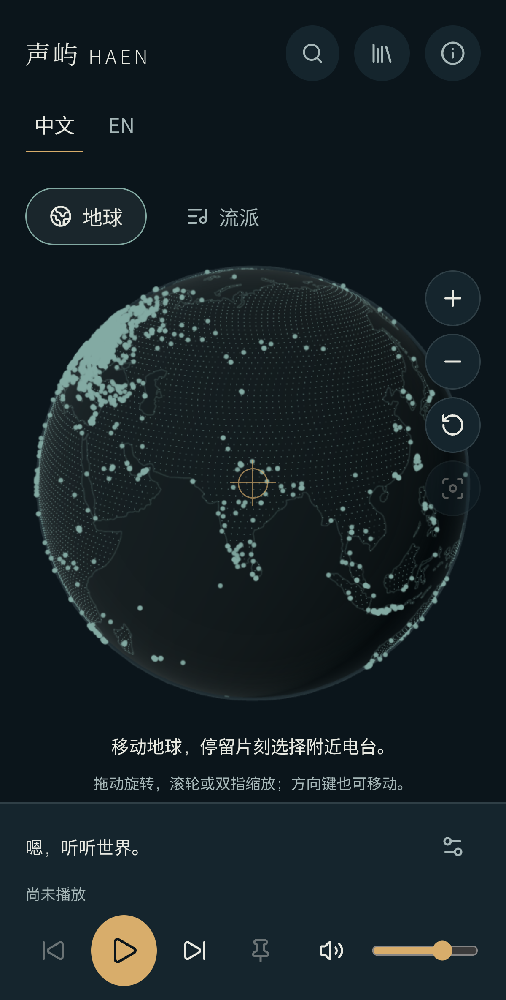
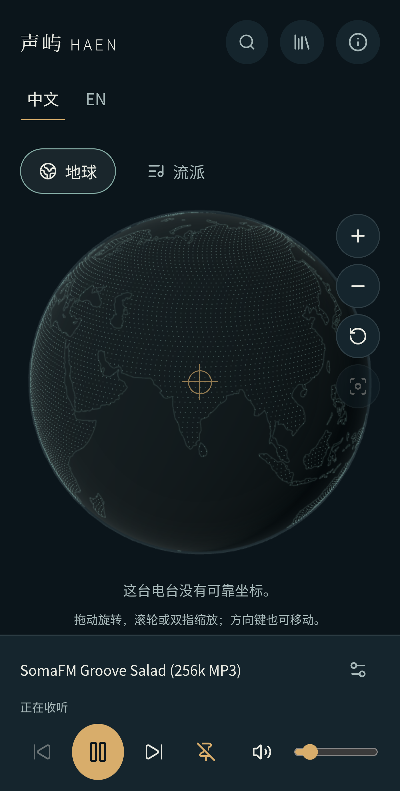

# Android 真实设备阶段验收

## 需求与本轮范围

在用户连接的真实 Android 手机上继续阶段8，核对实际触摸、真实电台与音频输出，并分别记录系统媒体、后台和息屏证据。新增[真实手机验收步骤](../../engineering/real-device-acceptance.md)、脱敏结果、项目页截图与导航；本轮不修改产品代码、样式、依赖、迁移或发布流程。

环境为小米23127PN0CC、Android16、Chrome155.0.8059.39，实际页面视口400×789 CSS像素、DPR3、屏幕400×890、五个触摸点。被测提交为01d0206c100c95b90a29a2d9c6c6ab6e37817733。服务是本机Vite/Fastify开发模式，经USB回环访问开发库的真实目录；音频由手机直接访问外部电台，没有替换API、目录或音源。它不等于生产包、公开HTTPS或移动网络验收。

## 已取得的证据

| 检查 | 结果与方法 |
| --- | --- |
| 首次进入 | 页面未自动播放、没有audio元素，WebGL面板ready；当前竖屏无横向溢出 |
| 真实目录 | 清单68816条，未筛选可用候选40567条；搜索SomaFM Groove Salad返回14条；Enter提交后刷新仍保留筛选 |
| 真实MP3播放 | CDP触摸选台，媒体时间从0.18576推进至16.036112及72.355107秒，readyState4、无媒体错误；页面音量12%，用户明确确认能听到声音 |
| 暂停与恢复 | 触摸暂停后进入paused，再触摸播放回到playing |
| 地球交互 | 在真实设备CDP发送单指拖动、双指缩放；画布内容变化、拖动未滚走页面，双指操作未放大整个网页 |
| 视图切换 | 地球与流派切换后，同一个真实电台继续播放 |
| 系统媒体控制 | 唯一匹配本项目当前电台的Chrome媒体会话；息屏期间发送Android媒体暂停键，系统状态变为PAUSED(2)，再发送播放键回到PLAYING(3) |
| 后台与息屏 | 断开Playwright后确认Android桌面前台及Dozing状态；直接CDP只读取项目页，visibility为hidden、无焦点，两个相隔102.083秒的样本均为hidden且未暂停，媒体时间增加102.093011秒；实际持续听音仍待用户确认 |

结构化时间点、原生状态与截图SHA256见[结果](results.json)。触摸输入是实际设备浏览器的CDP触摸事件；文本、Enter与音量键盘操作不冒充人工手指或中文输入法验收。

最初调试时遇到软键盘可见视口与坐标不匹配、旧标签页会话失效，修正测试操作后已完成实际选台。Playwright连接会启用焦点模拟，导致系统桌面前台时document.visibilityState仍为visible；该观测没有被算作隐藏页面通过证据。之后重置调试内核，并改用不启用焦点模拟的直接CDP读取，实际得到hidden及媒体状态。系统媒体会话的position没有持续刷新，未将其当作解码时钟。没有为这些测试工具差异修改产品逻辑。

两张截图仅包含项目网页，无设备序列号、系统通知、账号或其他标签页；不是移动视口模拟截图。

## 数据库核对与执行状态

API和迁移身份均可连接MySQL8.0.46；私有配置仍是开发库ha_radio_dev，经已核对StrictHostKeyChecking=yes的SSH回环连接。只读元数据确认9张表（含历史表）、两条已应用迁移，与之前记录一致。迁移status因维护身份缺少完整元数据可见性而拒绝，并非手机故障或证书握手失败。

缺少的可见性为项目库SHOW VIEW/TRIGGER/EVENT及全局SHOW_ROUTINE或既有等价可见性，详见[预检权限](../../data/migrations/target-preflight.md)。本轮没有自动提升权限，也没有绕过校验。0002_playback_diagnostics.sql仍只在既有隔离验收中执行；本轮没有执行SQL写入、建表或历史修正，正式库未接触。故障报告的开发库实际写入验收继续待迁移和最小权限条件具备。

## 尚未完成与交付边界

息屏持续声音和解锁恢复仍待用户现场反馈；本轮系统媒体按键通过不能代替真实来电、其他应用音频焦点抢占、断网恢复或耳机控制。AAC/HLS实际手机线路、横屏与软键盘遮挡、完整收藏/分享/刷新流程、系统文件选择器、TalkBack、系统字体、真实帧率和长期稳定性仍需后续验收。Android整项因此保持未验证，并单独列出本轮已通过子项。

iOS Safari没有连接的可用测试设备，不以已配对记录替代验收。Docker按用户要求留到实际部署时测试；本轮没有Jenkins、Linux、镜像上传或发布。完整目标保持进行中。

## Review与验证

Review只覆盖本轮12个文档/证据文件；核对实际设备与模拟的区别、播放状态与声音的区别、调试器焦点影响、SQL只读状态、隐私和未完成范围，无未解决问题。文档检查通过107份Markdown与678个本地链接，结构化结果格式、截图SHA256/尺寸和差异空白检查通过；仅文档和证据变化，没有以本轮名义重复运行应用构建或扩大已有自动化结论。

同步upstream没有新增提交，12个任务文件的字节与权限完整恢复，随后重新Review并复跑适用文档检查。任务结束已通过系统媒体暂停当前电台，复查系统状态PAUSED(2)；关闭本轮开发服务，确认3001/5173端口无监听，并只删除本轮建立的USB回环和调试转发。没有清除浏览器数据或其他标签页，继续手机验收时需重新启动服务并连接项目页。

返回[产品进度](../../product/progress.md)、[验收矩阵](../../product/acceptance.md)或[归档导航](../README.md)。
