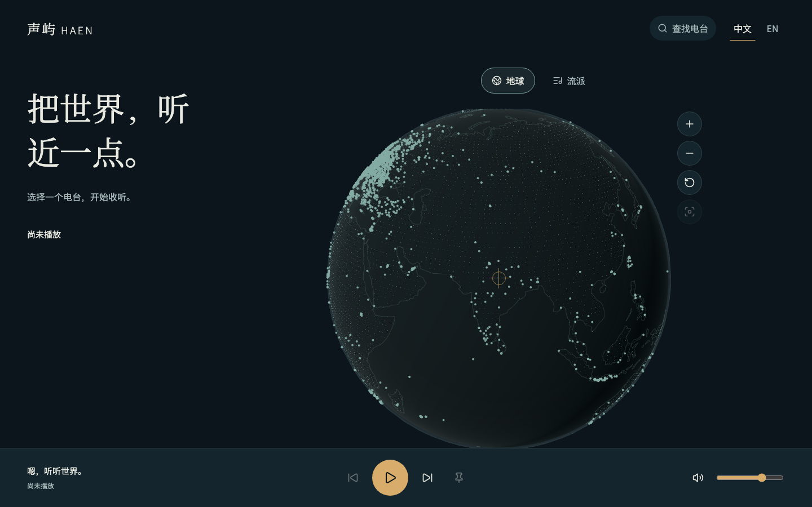
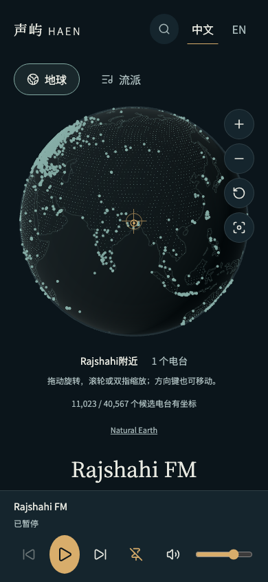

# 夜航探索界面

## 需求与变更

继续产品阶段 4：沿用已确认的夜航风格，将完整真实目录接入立体地球、流派视图、地点展开、自动选台、固定与双端布局，保留无图形能力时的列表播放。

- 新增 13 字段精简场景契约，分片与屏蔽摘要一致；浏览器校验完整性、最多并发 4 片、缓存最近两个完整版本。详情与播放地址继续按需获取。
- 原生 Three.js 地球使用本地大陆轮廓和点阵，支持拖动、滚轮、双指缩放、键盘与触屏按钮；图形不承载虚构电台坐标。
- 准星候选稳定约 650ms 才选择；固定、暂停、明确选台和数据更新共同防止迟到的自动动作覆盖新意图。
- 流派使用疏朗样本点簇与真实总数，选择后提供可操作列表。已知城市与附近坐标分组区别表示，同名异地不会只凭名称合并。
- 本地分发三种夜航字体与许可证；显示可靠坐标、收听语言和有证据的当地时间。
- 图形初始化失败保留静态地理画面与列表；上下文丢失和恢复不重启音频。

## Review 与修复

检查仅限本次契约、接口、目录缓存、图形资源、组件、字体、测试与相关文档。重点核对版本并发、屏蔽规则快照、旧请求取消、候选一致性、暂停与固定时序、资源销毁、图形降级、双语和可访问性。

修复了分片查询期间屏蔽缓存变化可能造成摘要与条目不符的问题；同一分片固定对应规则。缓存明确核对请求键，并拒绝重复或不完整条目。目录上限与服务端注册表保持一致，未以较小客户端上限截断已发布数据。

真实完整目录复核暴露了分片读取过多详情与重复统计的问题，已改为 MySQL 直接投影 13 个场景字段，并在同一次查询中限制为已发布版本；不再为每片读取线路与全量标签或重复统计。隔离 MySQL 用例同时覆盖投影一致性、未知版本、未发布版本和越界分片。

上下文中断时，画布宿主同时设置 `inert` 与隐藏语义，防止键盘仍进入不可用画布；恢复后重新允许聚焦，浏览器验证同时覆盖声音不中断与焦点恢复；补充修复后 8 项降级及上下文测试通过，格式、Lint、类型、77 项普通测试与构建复验通过。

浏览器初测发现按相机浮点数完全停止来计时会让低帧率下的自动选台被惯性余动延后，已改为准星候选稳定计时，并在执行时复核当前候选。自动动作额外读取播放器最新状态，尊重刚发生的暂停、固定、明确选台与加载操作。

暂存检查发现上游许可带有 CRLF 与行尾空白，已在生成器及本地许可中统一换行和行尾格式，并逐词确认原条款与版权文字未变；未关闭 Git 空白检查。

## 验证状态

真实开发目录未拦截 API：68,816 条记录、69 片全部进入 IndexedDB；40,567 个可播放候选，其中 11,023 个具有坐标。一次本机 Chromium 冷加载 33,169ms，刷新缓存 837ms、零分片重取；这只是当前网络的一次记录，不代表性能上限或真实手机结果。全程无页面或控制台错误，自动选择保持暂停且未创建音频元素。

视口覆盖 1440×900、768×1024、390×844、320×740、844×390；均无横向溢出，单一画布。390px 下将实际文字字号放大至 200% 后仍可纵向阅读；播放器高度测量为桌面 105px、手机 133px，正文预留对应空间。截图已人工查看字体角色、配色、地球体积、操作入口与底部播放器；较长内容通过正常滚动查看。

[手机 200% 文字](assets/mobile-text200.png)。最终回归：冻结安装、格式、Lint、类型检查、77 项普通测试、前后端生产构建及文档检查通过；Chromium、Firefox、WebKit 与移动 Chromium 共 61 项通过，3 项仅适用于移动 Chromium 的触摸合成测试在桌面项目中不适用。隔离 MySQL 8.0.46 的 6 项验收通过，并清理本轮临时库；包含两条既有迁移的初始化、升级、保留、重复迁移和新投影查询，没有新增迁移。

Vite 保留 500kB 分块提示：主入口约 489kB（gzip 153kB），懒加载图形 566kB（gzip 141kB），懒加载 HLS 574kB（gzip 179kB）。尚未完成真实设备与长时间资源趋势验收，不能把一次缓存计时视作完整性能验收。

修复后已复审本任务差异，未发现未解决的阻断问题。同步 upstream 未发现远端新提交；备份恢复后逐文件摘要与原权限一致、暂存区为空。同步后复审相同任务范围，并执行检查、构建、浏览器与隔离 MySQL 复验；Git 提交及远端结果由仓库记录追溯。

## 更新顺序、SQL 与遗留

影响 Web、API 和共享契约；先更新 API 再更新 Web，独立任务和数据库结构无新增要求。开发目录继续使用已发布版本，不执行正式库 SQL，不触发 Jenkins 或上线。Docker 实测留到用户实际部署时执行。

完整产品仍需个人工具、曲目、歌词、识曲条件项、兼容性能与部署交付；真实 Android/iOS 的触摸、声音、后台和系统中断单独验收。

返回[归档导航](../README.md)。
