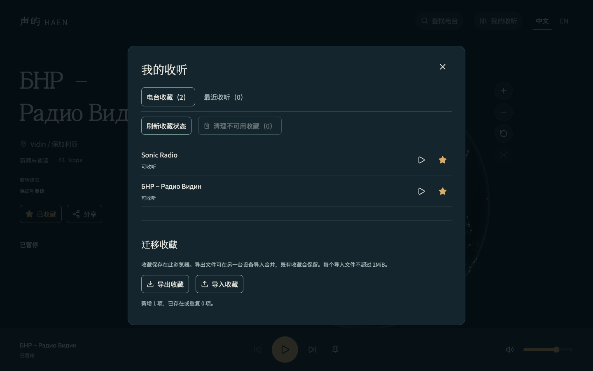

# 本地收听清单与筛选

## 需求与实现

继续完整产品第 5 阶段，交付多维筛选、电台收藏、成功收听历史、刷新与分享恢复、收藏文件迁移。设置、睡眠、快捷键和系统媒体仍属于本阶段后续工作，不能将当前清单当作阶段 5 已全部完成。

- 流派与语言支持多选；同维并集、跨维交集，空数组为零结果，全部用明确状态表示。语言最多显式选择 32 种，提供名称与代码查找。列表、场景与随机入口使用相同候选；目录暂不可用时，收藏范围通过分批查询恢复，不能回退到全站随机。
- 收藏与历史采用独立本地记录，浏览器标签页通过实际存储事件更新，读取当前值而非迟到的事件副本。收藏保存 ID、名称与国家快照，不保存播放地址；目录更新不会直接删除收藏。
- 最近收听只在音频实际进入播放后记录，按 ID 去重、最多 100 台。清空同时删除上次收听恢复项，确认文案说明范围；收藏继续保留。
- 共享链接优先于上次成功收听；恢复保持暂停，没有用户播放动作不创建媒体。非法或不存在的分享给出说明和继续探索入口，不清空筛选。
- 原生模态面板支持关闭、Escape、焦点返回、正常滚动和双端入口；收藏状态查询失败不推断下线。已确认不可用的收藏通过二次明确操作清理。
- 迁移文件使用 `haen-favorites` 格式号 1；每个输入先检查 2MiB 字节大小再解析，严格校验后合并，既有收藏优先。歌曲收藏随文件保存并在后续曲目界面使用；较大导出分卷，每卷可独立导入。
- 存储拒绝、配额错误、损坏和未知版本均保留会话能力并明确告知限制；不覆盖无法读取的旧记录。

## Review 与验证

Review 范围仅为本次前端清单、筛选、请求封装、播放恢复入口及配套测试和文档。重点检查跨标签页独立记录、迟到事件、导入完整校验、文件大小、状态缺失、错误降级、旧请求失效、播放意图、焦点和双语。

已处理日期范围、空筛选语义、跨标签页搜索草稿、收藏缩减后的分页、导入不覆盖既有快照、失效链接不自动回退播放等边界。冻结安装、格式、Lint、类型、87 项普通测试、前后端构建和文档检查通过。Chromium、Firefox、WebKit 与移动 Chromium 的完整回归共 97 项通过，3 项桌面触摸合成不适用；新增 9 个个人清单场景分别在四个项目验证。普通测试中的 6 项 MySQL 用例不适用于本次纯 Web 变更，未重复运行；此前结果继续见数据库阶段记录。

浏览器初测发现桌面信息区吸顶会覆盖下方展开筛选，已取消该区域吸顶，底部播放器继续固定。模态关闭后显式将焦点返回打开入口，适配鼠标点击不默认聚焦按钮的浏览器；修复后重新检查触屏目标与布局。

跨标签页的连续存储事件以 16ms 窗口合并发布，只重新排序受影响的清单；避免批量导入时每条事件都重建全部列表和查询。100 条事件突发、迟到事件读取与卸载取消已纳入普通测试。

复审将“状态未知”与已确认不可用分开：未知项保留并允许显式重试，不能加入清理集合；扩展浏览器用例验证未知、缺失和屏蔽三种状态。

复审结论：本次任务范围内无未解决的阻断问题。两次同步均无远端新提交，恢复后 39 个文件的摘要与权限一致；同步后 87 项普通测试、检查与构建通过，未知状态修复后的 4 项针对浏览器验证通过。完整回归的 97 项结果与后续针对复验分开记录，不将不适用项计为通过。

## 双端与真实数据证据

开发 API 未拦截：从真实目录选取电台，分享入口以暂停状态打开，收藏两台并导入其中一台的快照，刷新后两项仍在，音频元素始终为 0。页面与控制台错误为 0；这是实际目录与本地清单验证，不把暂停选择当作声音输出验收。

面板在 1440×900、768×1024、390×844、320×740、844×390 下均完整位于视口，面板和页面无横向溢出。390px 英文界面全部文字放大到 200% 后仍可滚动使用；关闭返回入口焦点。已人工核对配色、字体角色、触屏操作、长名称与面板内的阅读顺序。

[桌面主界面](assets/main-desktop.png)、[手机英文 200% 文字](assets/mobile-text200-en.png)。

本轮本地字体总大小约 188kB；主入口 518kB（gzip 162kB），图形与 HLS 继续按需加载。Vite 的 500kB 分块提示保留，完整资源预算和真实设备性能仍在后续阶段验收。

## 交付边界

仅影响 Web；无新增数据库表、迁移、权限或服务变量，API 的既有批量查询继续使用原契约。未执行正式库 SQL、Jenkins 或部署。Docker 按用户要求留到实际部署环境测试。

后续继续刷新后的上一站导航、设置、睡眠、快捷键、Media Session、曲目、歌词、识曲条件项和部署材料；真实 Android/iOS 与长期资源趋势仍单独验收。

返回[归档导航](../README.md)。
