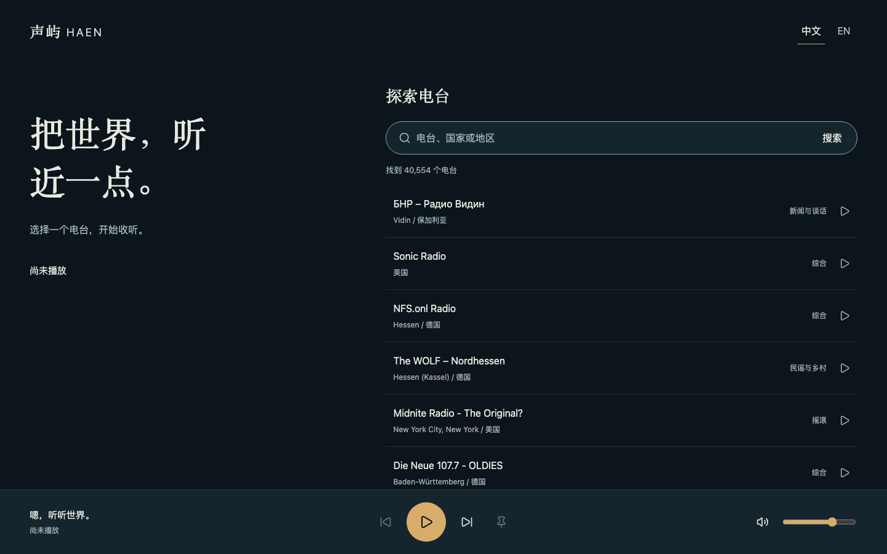
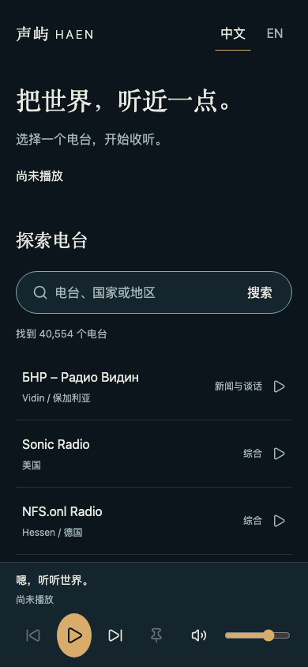

# 真实播放闭环

## 需求与实际变更

完成产品阶段 3：从真实目录搜索和选台，以独立引擎播放 MP3/AAC/HLS，处理连接、缓冲、暂停、浏览器手势、备用线路、快速切台与有限恢复。继续沿用夜航配色、字体角色和双端布局，地球和完整探索界面由下一阶段接入。

- 新增 AudioEngine 与 HLS 适配器，媒体和线路生命周期独立于 React；Zustand 协调选中台、播放意图和实际状态。
- 新增双语搜索与分页列表、上一站、随机下一站、固定、播放暂停、音量、静音和显式重试。成功收听导航暂在本次会话保存，持久历史仍属后续阶段。
- 同台最多 3 条线路，每条连接或持续缓冲上限 8 秒；未固定时最多自动尝试 2 个其他电台，排除本轮失败台，不无限重试。
- API 增加可选 playableOnly 和 excludeIds 参数，候选范围在数据库中参与总数与分页计算；保持原有请求的默认行为。
- hls.js 1.7.3 按需加载，Lucide React 1.57.0 提供图标，Zustand 5.0.15 管理协调状态，具体版本和锁文件已固定。
- 加入自制低振幅 MP3、AAC 与 HLS 测试音及再生成脚本，仅在测试路由中使用，不进入产品默认数据。

## Review 与修复

仅审查本次代码、契约、媒体样例、检查配置和文档。重点核对用户手势、播放意图与实际事件分离、旧响应失效、HLS 资源清理、失败上限、固定语义、候选一致性、双语和手机布局。

修复了选台时短暂 paused 状态覆盖播放意图、生命周期重放后选中台无法再次播放、暂停发生在详情加载期间仍自动播放，以及自动恢复可能重新选中已失败电台的问题。补充修复了旧媒体排队的 pause 事件取消新台播放意图的问题，并增加正在播放时切换慢响应电台的协调与浏览器回归。检查同时覆盖系统暂停、离线后显式恢复、媒体事件和 Promise 拒绝迟到。

Firefox 的清单加载中暂停用例暴露 HLS 初始清单被取消后 startLoad 不会重新请求的问题。通过固定当前台阻止自动换台掩盖失败，修正为初始清单未解析时恢复请求，再复测通过。浏览器原生媒体对一条真实来源返回 403，已将提示改为源读取失败，不误判为 MP3 编码能力。

一次数据库验收与共享包重建并行，导致测试加载期间 dist 暂时缺失；该次未计为通过，改为串行构建和数据库复验。应用代码未通过忽略检查来掩盖该问题。

## 验证结果

- 冻结安装、格式、Lint、strict 类型检查、52 项普通测试及生产构建通过；端到端 TypeScript 也纳入工具检查。
- Chromium 156、Firefox 157、WebKit 27.2 和 Pixel 7 模拟视口共 36 项浏览器检查通过，包括 MP3/AAC/HLS 实际解码、时间推进、暂停恢复、备用线路、迟到请求和 HLS 清单加载中暂停。
- 原生 MySQL 8.0.46 隔离流程验证候选条件与失败 ID 排除，沿用初始化、升级保留和连接池验收；无新增业务迁移，临时测试库完成后清理。
- 真实目录选取 10 个独立电台，9 台进入播放且媒体时间持续推进，1 台浏览器请求 403；逐台信息见[真实电台记录](real-stations.md)。没有将外部来源失败写成可控样例失败，也没有宣称所有电台均可播放。
- 当前列表和播放器在 1440×900、768×1024、390×844、320×740、844×390 检查无横向溢出；390×844 的 200% 文字放大检查通过。正文预留播放器实际高度和安全区。
- 实际扬声器输出、Android/iOS 真机、锁屏和后台中断尚未验收；浏览器媒体状态不能代替这些检查。

当前构建主包约 143KiB gzip，HLS 独立包约 179KiB gzip。HLS 包超过构建器默认原始大小提示线，但只在原生 HLS 不可用且确有 HLS 音源时加载；未提高警告阈值掩盖提示。完整资源预算与持续播放内存检查留在性能阶段。

## 界面记录

以下截图使用真实开发目录，展示当前列表和播放器；地球尚未接入，不能当作完整探索界面验收。

## SQL、更新顺序与未完成项

涉及 Web、API 和共享契约；任务调度和数据库结构无新增变更。开发库原两条迁移保持原样，正式库未执行 SQL，也未发布或触发 Jenkins。更新时先 API、后 Web，确保新候选参数生效。

Docker 实测按用户要求延后到实际部署。下一阶段完成地球、流派视图、离线地名与地图资源，随后推进个人工具、曲目、歌词和部署材料；完整产品目标仍未完成。

返回[归档导航](../README.md)。
