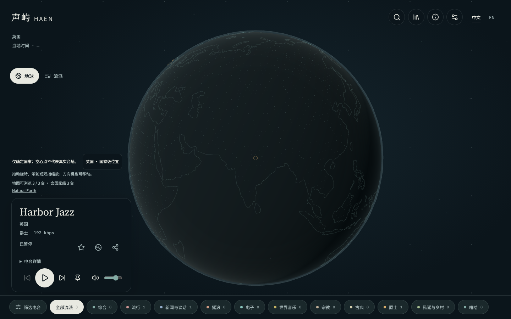
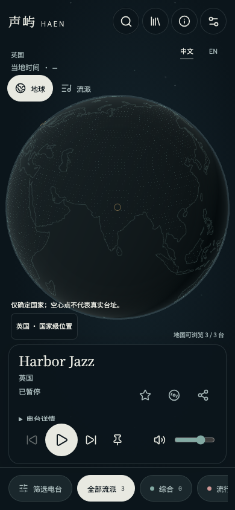

# 全屏地球与紧凑播放器

日期：2026-10-18。状态：实现与验证完成，待发布。

## 需求与实际变更

- 地球居中，解除双栏与框体限制；保留手势/键盘操作，移除放大、缩小、重置和定位按钮。
- 品牌下显示当前地点、可核实的当地时间、地球/流派切换；没有可靠时区时显示占位。
- 左下播放器整合电台标题、地点、码率、流派、收藏、分享、沉浸、播放状态和详情及播放控制；地图精度、提示、数量与地理署名在其上方。
- 顶栏只显示图标；搜索就地伸展，兼容中文输入法并实时筛选。收藏、帮助与设置改为紧凑非模态面板，保留关闭、Escape 和焦点返回。
- 移除曲目与歌词、手动识曲入口；既有后台接口和本地歌曲数据继续兼容。
- 底部流派条带真实数量与分类色点，支持选择及完整筛选；重整流派探索视觉。
- 外围稀疏星点，电台带柔光和错开的缓慢明暗变化；省电、减少动态效果、标签页隐藏和场景切换时停止非必要绘制。
- 中英界面复用原有翻译与字体字形，本次无新增依赖和环境变量。

## Review 与验证

本次只审查当前任务差异，覆盖布局、非模态面板、焦点、搜索输入法/取消、筛选数量、真实播放状态及图形资源生命周期。横屏播放器信息区与控制行分开，避免长信息滚动遮挡播放操作。

- 前端单元测试 23 个文件、101 项通过；格式、ESLint、前端类型检查、Vite 构建、资源预算和文档链接检查通过。
- Chromium 既有回归中 66 项通过、1 项桌面触摸合成不适用；发现的同城光点点击、短循环音源校准断言与规模用例时限问题已修正，三项独立复验全部通过。规模场景使用 30,000 条合成电台、60 次切换，保留堆/节点/监听器与请求数量限制，时限按实际界面操作调整到 300 秒，实际约 3.3 分钟完成。
- 同城/国家重叠点点击现在将完整地点分组交给面板，自动停留选择仍针对实际光点。无障碍扫描修正了非模态面板标题被浏览器重复视为页面顶栏的问题，中英扫描通过。
- 最终跨浏览器布局与地点点击复验 52 项全部通过，覆盖 Chromium、Firefox、WebKit 与 Pixel 7 模拟项目；检查 1440×900、768×1024、390×844、320×700、844×390，含双语 axe、展开搜索、流派筛选、紧凑面板、键盘及减少动态效果。
- 浏览器音源均为可控测试夹具；本地真实目录仅作页面渲染检查，不能据此宣称真实外部电台音频或生产发布已验收。

## 发布与未完成事项

只需通过 `radio-frontend` 发布前端静态产物。`radio-api`、`radio-jobs` 无需更新；无数据库迁移、无 SQL 执行、无配置调整和更新顺序要求。本次不触发 Jenkins、不上传镜像、不执行生产发布。

桌面与手机视口模拟不能替代真实手机触摸、音频输出、后台行为验收；本次不追加这些环境专项。

返回[任务归档](../README.md)与[前端导航](../../frontend/README.md)。

## 页面截图

截图使用三个可控测试电台，用于核对布局，光点密度不代表真实目录。

