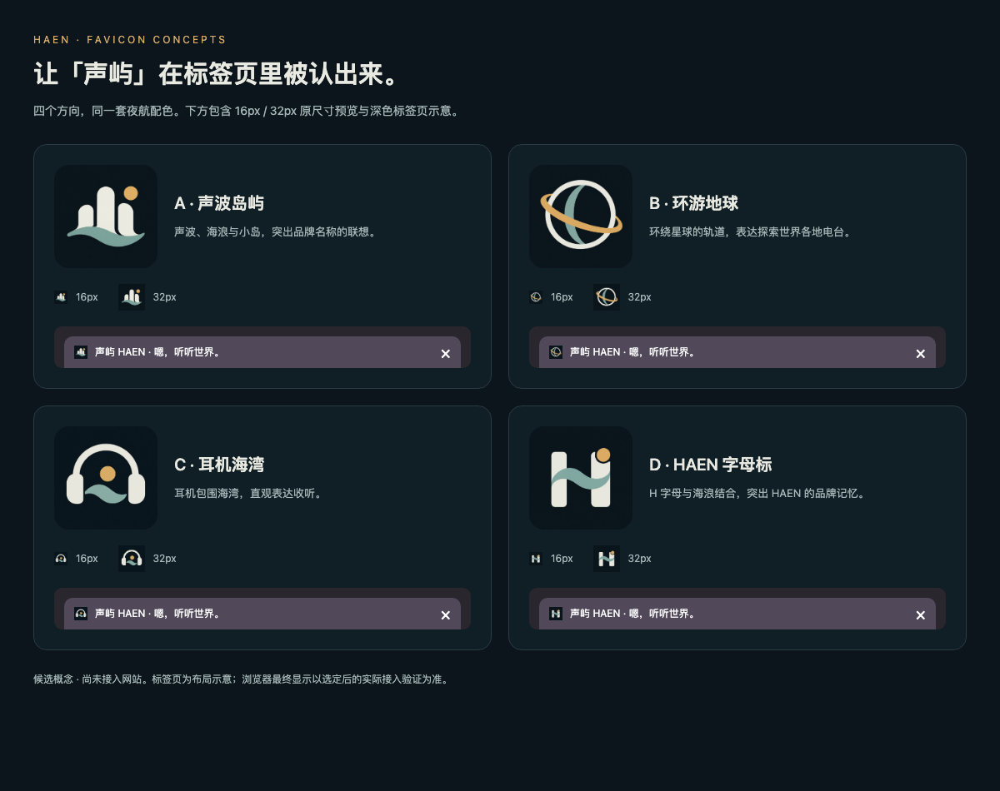
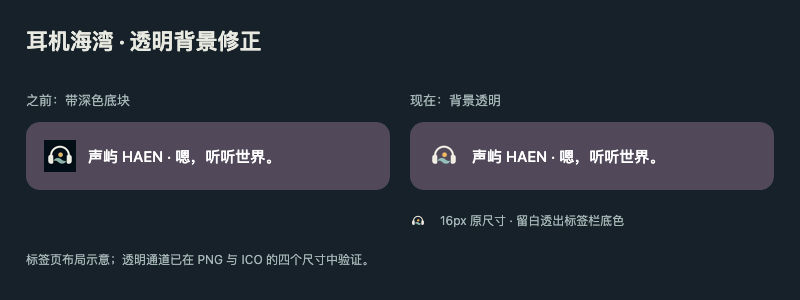

# 标签页图标候选

日期：2026-10-18。状态：已选择 C「耳机海湾」，并按用户反馈改为透明背景 v2；已接入前端源码，本次修正尚未发布。

## 需求与交付

为「声屿 HAEN · 嗯，听听世界。」设计主要用于浏览器标签页的图标，提供多个方向供选择。沿用[夜航配色](../../frontend/design/night-voyage.md)，不在小图标中加入完整品牌文字。

| 方案 | 图片 | 含义 |
| --- | --- | --- |
| A · 声波岛屿 | [PNG](assets/a-sound-island.png) | 声波、海浪与小岛，强化名称联想 |
| B · 环游地球 | [PNG](assets/b-world-radio.png) | 星球与轨道，表达全球电台探索 |
| C · 耳机海湾 | [PNG](assets/c-listening-bay.png) | 耳机与海湾，直观表达收听 |
| D · HAEN 字母标 | [PNG](assets/d-haen-monogram.png) | H 字母与海浪，突出品牌记忆 |

生成方式：内置 image_gen，每款独立生成一张图。完整提示词见[提示词记录](prompts.md)。候选 PNG 保留生成原图，不作为最终 favicon 规格交付。

[对照页面](preview.html)提供大图、16px / 32px 原尺寸预览与深色标签页布局示意。页面只使用本地图片，无脚本及外部请求；标签页为示意，不代表实际浏览器已加载新图标。

另附[手机宽度对照](assets/comparison-mobile.png)。

## 候选阶段 Review 与验证

- Review 范围仅包含本次候选图片、对照页面、提示词、归档和导航；没有应用代码或部署配置修改。
- 已目视检查四款原图的构图、元素及整体夜航色系；均为单图标、无文字，保留足够边距。最终选定后仍需按小尺寸重绘及简化。
- 本次内容自审及截图目视复核未发现未解决问题；四款概念可区分，图形边距及小尺寸表现可供选择，B 的轨道结构在 16px 下细节较多，定稿时应继续简化。
- Playwright / Chromium 无头浏览器分别以 1200×950、390×844 视口渲染对照页面；全部 16 个图片实例加载成功、四个方案齐全、16px / 32px 显示尺寸正确、无横向溢出及页面脚本错误，并保存对应截图。此处仅验证本地候选对照页，不属于网站双端验收或真实设备验收。
- `pnpm docs:check`、对照页面的 Prettier 格式检查及 `git diff --check` 通过；本轮未修改应用代码，不运行应用构建。
- 尚未执行真实浏览器 favicon 接入、跨浏览器缓存刷新或手机主屏图标验证；本轮不改变应用界面，不需要应用构建及播放回归。

## 初次选定与接入（v1，已由透明版替代）

用户确认采用 C「耳机海湾」，并要求替换此前标注的浏览器标签页图标。用户回传图片与归档 C 图经 BMP 解码导出比对一致；保留原图的耳机、海浪、琥珀圆点及深海背景，不重新生成或调整造型。

- [32px PNG](../../../apps/web/public/haen-favicon-v1.png)：标准 PNG 图标。
- [多尺寸 ICO](../../../apps/web/public/haen-favicon-v1.ico)：包含 16、32、48、64px 四个 PNG 编码图层，供浏览器选择适合的尺寸。
- `apps/web/index.html` 显式声明两种图标，通过 Vite 的 `%BASE_URL%` 同时支持开发根路径与正式 `/radio/` 路径；文件名带 `v1`，为此次新图标提供独立缓存地址。
- 资源由原图使用 macOS `sips -z <尺寸> <尺寸>` 等比缩小导出，ICO 按标准头部及目录封装各尺寸 PNG；普通前端构建直接使用已提交产物，不依赖 macOS 或源图片临时路径。

接入改动仅包含上述资源和 HTML 元数据，不改变页面布局、播放器或其他操作图标。

### 接入 Review 与验证

- 自审范围：HTML 图标声明、PNG / ICO 产物及本次文档更新。已检查选图一致性、ICO 目录与像素格式、资源体积、Vite 基路径及发布边界；修正 ICO 目录位深使其与 RGB PNG 的 24 位一致后复审，无未解决问题。
- `pnpm --filter @haen/web build` 以及 `HAEN_WEB_BASE_PATH=/radio/ pnpm --filter @haen/web build` 均通过，包含前端 TypeScript 检查；构建保留既有分块体积提示。PNG 约 2.1 KiB，ICO 约 11.6 KiB。
- Chromium、Firefox、WebKit 分别在 1440×900 电脑视口与 390×844 手机视口下，验证两种生产构建的图标声明、URL 前缀、HTTP 200、文件内容一致及 PNG / ICO 图片解码，共 12 种组合通过。ICO 目录的 16 / 32 / 48 / 64px 图层及 PNG 尺寸检查通过。
- 此次浏览器检查隔离了应用脚本，仅覆盖生产 HTML 元数据及图标资源；不等于完整应用、原生标签栏视觉、真机或音频验收。详细脱敏结果见[验证记录](favicon-validation.json)。
- `pnpm docs:check`、`apps/web/index.html` 与验证记录的 Prettier 检查、`git diff --check` 均通过；代码同步后针对本任务差异复审，无远端相关代码变化时复用上述构建及浏览器结果。

## 透明背景修正（v2）

用户反馈标签页图标不应有黑色底块，要求透明背景。使用内置 image_gen 去除背景并清理边缘，保留耳机、海浪和琥珀圆点的主体构成与配色；图形之间的留白同样透明。

- [透明源图](assets/c-listening-bay-transparent.png)，生成提示词见[提示词记录](prompts.md)。
- 当前使用 [v2 PNG](../../../apps/web/public/haen-favicon-v2.png) 和 [v2 ICO](../../../apps/web/public/haen-favicon-v2.ico)，PNG 为 32px RGBA，ICO 包含 16 / 32 / 48 / 64px 四张 RGBA PNG，目录位深为 32 位。
- `index.html` 改为引用 `v2` 文件名，避免沿用旧的深色底图标缓存；继续使用 `%BASE_URL%` 适配根路径及 `/radio/`。
- v1 文件及对应验证记录仅保留作历史归档，当前页面不再引用 v1。普通构建不依赖图像生成工具或临时源文件。

本次 Review 仅覆盖透明素材、图标引用与相关归档，确认资源为 RGBA、ICO 四个图层均保留 alpha、引用使用独立 v2 地址，无未解决问题。

- 根路径及 `/radio/` 的生产构建通过，包含前端 TypeScript 检查；保留既有大分块提示。
- Chromium / Firefox / WebKit 在 1440×900 及 390×844 视口下，共 12 种组合通过生产 HTML 引用、HTTP 200、响应内容一致、PNG / ICO 图片解码及透明度检查。
- 使用 Canvas 读取实际解码像素，验证 PNG 及 ICO 内 16 / 32 / 48 / 64px 四个图层的四角和内部留白 alpha 均为 0，同时保留不透明主体像素；各图层至少一半像素完全透明。结果见[透明度验证记录](favicon-transparency-validation.json)。
- 已目视复核[修正前后对照](assets/transparency-preview.png)，新版图标能直接透出紫灰标签栏底色。此图为标签页布局示意，未进行线上原生标签栏、真机或音频验收。
- `pnpm docs:check`、修改 HTML 和验证记录的 Prettier 检查、`git diff --check` 通过；同步后复审本任务差异并复验文档及资源一致性，无相关上游变化时复用构建及浏览器证据。

## 待完成事项与服务影响

待执行前端发布后核对线上浏览器标签页；已有浏览器可能需要重新打开标签页或刷新图标缓存。手机主屏等其他用途不在本次范围。

本次需要更新前端静态资源（`radio-frontend` 发布任务）；API（`radio-api`）和后台任务（`radio-jobs`）无需更新，无数据库迁移、配置调整或发布顺序要求。本次没有执行发布。

返回[归档导航](../README.md)及[前端导航](../../frontend/README.md)。
