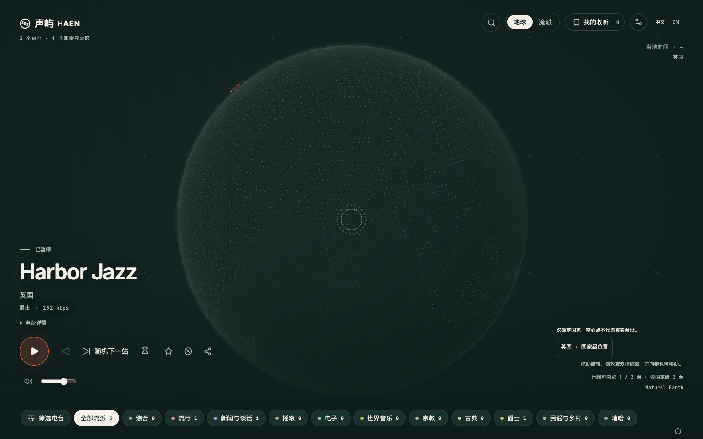

# 全系统样式统一

日期：2026-10-18。

## 需求与范围

按用户要求整体统一系统样式，覆盖探索、播放器、搜索、收藏、历史、筛选、设置、帮助和沉浸画面；保持声屿 HAEN 品牌、现有接口与业务能力。

## 实际变更

- 增加首次进入的欢迎收听入口，支持直接开始或先浏览；拒绝 sessionStorage 时在内存中运行。
- 全局变量改为墨绿、暖白与珊瑚橙，按钮、标签、开关、输入框和浮层统一轮廓。
- 桌面播放器去掉独立卡片，状态置于标题上方，操作分层；视图切换移到顶部工具区，收藏显示数量，目录统计置于品牌下方。
- 地球扩大构图，使用规则海洋点阵、暖白电台辉光和珊瑚橙选中点；保留逐台标记、国家级空心点、螺旋展开和省电降级。
- 流派改为柔和点光与加法混合。手机使用衬线标题、独立时间与地图信息，保留完整收听操作及流派条。
- 新增本地 Inter、JetBrains Mono 及 OFL 许可，更新字体生成清单；运行时不访问外部字体服务。
- 设置面板维持至少 44px 点击目标，显式循环 Tab 焦点，兼容 WebKit 的键盘行为。
- 浏览器测试的短音频使用连续播放夹具；音量校准测试将真实媒体延长而保留独立短采样，避免截图与滚动耗时被误判为直播停止。生产音频引擎未改动。
- 更新设计规范和协作规范，避免后续界面恢复旧配色。

## 实现边界与资源

界面和图形均由项目组件实现。新增外部资源仅包含两个 OFL 字体家族，其来源、许可、字重、字形与摘要见 `apps/web/public/fonts/source.json`。本次不引入第三方应用代码、图片、音频或远程运行依赖。

页面为单屏应用，覆盖顶部导航、透明播放器、地球、流派、搜索、通用面板、设置、信息与沉浸等九组界面。色值、圆角和字体角色使用明确参数；实际目录、动态粒子、地理分布、字体回退和原有业务能力会带来画面差异，未认定为逐像素相同。

## Review 与验证

Review 仅覆盖本任务差异，核对了主题变量、响应式布局、真实播放状态、目录统计、焦点循环、资源释放、字体许可、隐私排除与发布边界。修复了移动端悬停导致按钮换位、WebKit 搜索工具被相邻按钮覆盖、筛选浮层遮挡控制、首屏语义和短音频夹具自然结束等问题。

| 检查 | 实际结果 |
| --- | --- |
| 格式、ESLint、前端 TypeScript | 通过 |
| 普通测试 | 302 通过，12 项数据库专项按既有条件跳过；本次不涉及数据库 |
| 四浏览器广泛回归 | 首批 279 通过、14 失败、3 按能力跳过；失败项修复后分组复验，未将首批结果写成全部通过 |
| 故障与相关界面复验 | 80 项批次中 75 通过、3 按能力跳过、2 个 WebKit 重复搜索失败；修复工具栏收缩后，最终 56 项交付回归全部通过 |
| 欢迎页可访问性 | 首次扫描发现主区域与署名区域语义问题，修复后四浏览器 4 项通过；应用组件测试 3 项通过 |
| 生产构建与预算 | `/radio/` 子路径构建通过，字体与 JavaScript/CSS 预算通过；沿用既有分包体积提醒 |
| 首屏量化核对 | 1440×900 与 390×844、DPR 1、中文、减少动态效果，2 个状态均通过当前阈值，分类为近似；桌面差异像素 2.59%、MAE 4.84，手机 5.59%、MAE 7.83 |
| 生产预览网络 | 量化核对中的控制台错误、页面错误、请求失败和额外站点请求均为 0；`/radio/api/v1/health/live` 成功 |
| 文档链接 | 通过，最终同步后再次检查 |

浏览器使用 Playwright 1.64.1 的 Chromium、Firefox、WebKit 与 Pixel 7 模拟项目。布局覆盖 1440×900、1280×720、768×1024、390×844、320×700、844×390；检查选台、暂停、重复搜索、输入法、收藏、筛选、设置、沉浸、键盘、文字放大与 WebGL 降级。不同批次存在重叠，不将通过数相加为独立用例数量。

首屏采用每通道差异阈值 16、差异像素比例上限 12%、MAE 上限 8。此结果仅覆盖首屏两个静态状态，不能推断动态地球和所有业务面板逐像素一致。正常探索仍保留完整筛选、地理精度提示、直接收听控制与独立数据分布。

同步后按任务差异再次复审；GitHub 与 Gitee 均无新增远端提交，41 个任务文件恢复后的摘要全部一致。同步后 12 项四浏览器复验、3 项应用组件测试、格式、ESLint、前端类型、`/radio/` 构建、资源预算及文档链接检查全部通过。

## 发布范围与未完成事项

- 只需更新前端静态产物，使用 `radio-frontend` 发布任务；本次未执行发布。
- 无需更新 `radio-api`、`radio-jobs`，无需配置调整或数据库迁移，未执行迁移 SQL。
- 本次浏览器检查不代替真实手机、真实声音输出或生产验收。

返回[任务归档](../README.md)与[前端导航](../../frontend/README.md)。
