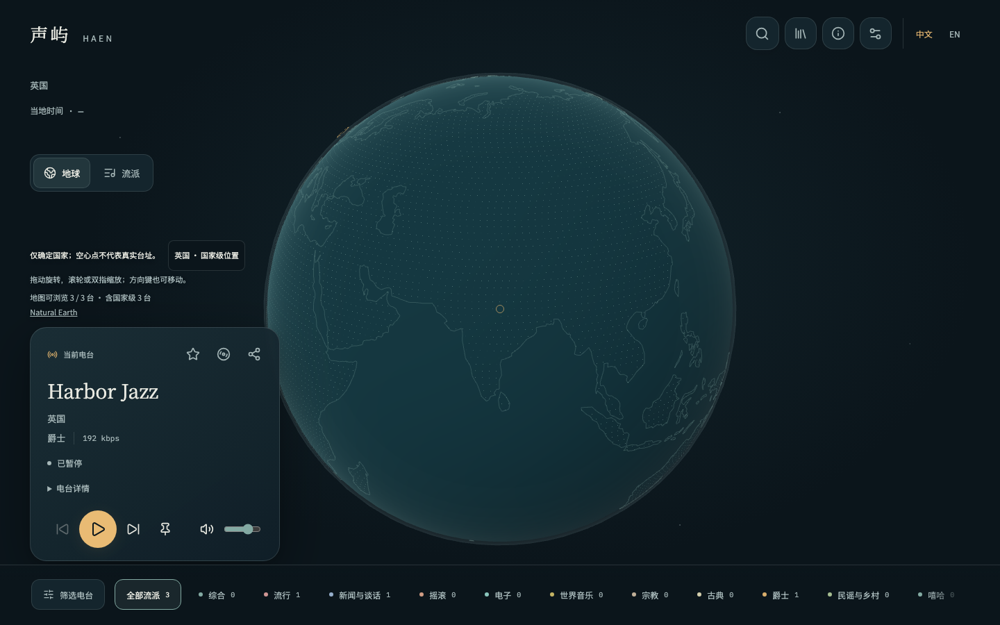
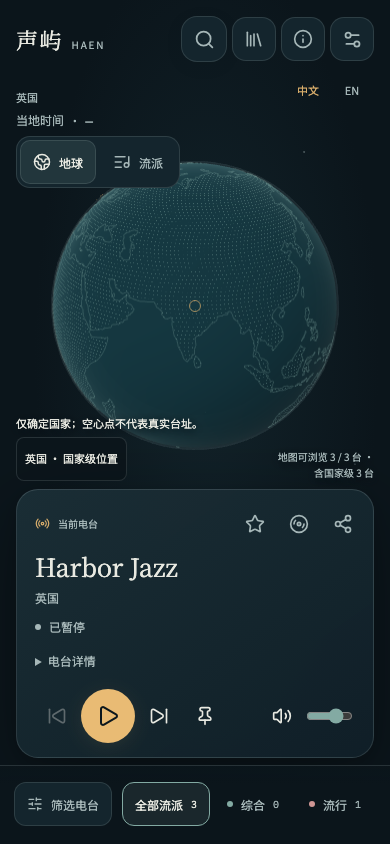
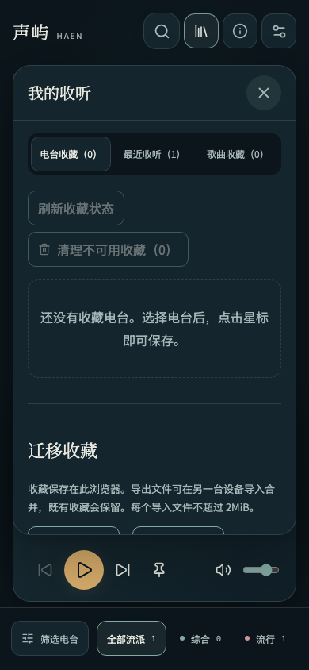
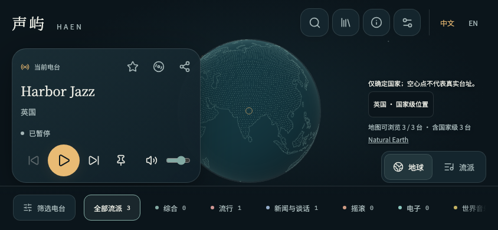

# 夜航页面整体优化

日期：2026-10-18。状态：实现与验证完成，未发布。

## 需求与实际变更

用户要求整体优化地图、弹窗、交互、展示与布局。在既有深海墨色、暖白文字、青灰与琥珀配色和全屏地球构图下统一细节，不新增业务功能或主要依赖。

- 地球改为视角空间的艺术明暗着色，增强海洋体积、点阵大陆和轮廓；边缘淡出与更小的电台光点减少密集目录的亮斑堆积。此明暗仅是视觉处理，不代表实时太阳、昼夜或天气。
- 统一品牌留白、图标工具栏、分段探索切换、流派导航、阴影和面板圆角，减少重复星点纹理和装饰噪声。
- 收听卡片重排电台操作、标题、地点、真实播放状态和播放控制；主按钮使用琥珀色，状态点仅连接真实播放器状态。长文本保留信息区滚动，播放控制独立。
- 搜索结果增加流派配色图形，新增清空搜索动作并返回输入焦点。搜索面板默认折叠筛选明细，通过摘要显示活动条件，避免筛选内容推走结果。
- 收藏、帮助、设置和地点浮层统一固定标题、独立内容滚动和关闭按钮；打开后焦点进入浮层，Escape 或关闭后返回入口，保留非模态行为。
- 设置优先展示播放、画面与睡眠选项，收听语言选择移到后部；切换控件、选中按钮、空状态与键盘提示统一处理。
- 手机端通过实际播放器高度分配地球空间，浮层为底部播放操作预留空间；横屏、窄屏、减少动态效果沿用独立适配。
- 复用现有中英翻译与本地字体，不新增翻译键、环境变量或服务端契约。

## Review 与验证

只 Review 本次任务差异，重点核对组件语义、搜索焦点、活动筛选反馈、非模态关闭、滚动与遮挡、真实状态、GLSL 编译和原有图形资源清理。截图与回归检查后修正手机浮层遮挡播放控制、较矮桌面窗口的面板重叠、Safari 设置入口焦点及浮层键盘循环问题。横屏收起重复地点区，地点与可靠当地时间仍可从播放器详情读取。

- 前端 23 个测试文件、101 项单元测试通过。
- 前端类型检查、ESLint、Vite 构建和资源预算通过；既有大分块提示仍存在，所有预算均在项目限制内。
- 最终 Chromium、Firefox、WebKit 与 Pixel 7 模拟项目覆盖 76 个场景：主回归 75 项通过，1 项高像素手机模拟在并发截图时触发 30 秒时限，单独复验于 19.6 秒通过。覆盖 1440×900、1280×720、768×1024、390×844、320×700、844×390，含双语 axe、清空搜索、固定浮层标题、关闭焦点、实际播放控制未被遮挡、逐台点位与省电。
- 横屏最后细节调整后，Chromium 布局、固定页面与浮层交互 3 项补充复验通过。
- 既有设置、收藏、帮助与可访问性回归中 24 项通过，涉及修复的 4 项在修复后独立复验全部通过，包含放大英文文字及跨标签页状态同步。
- 浏览器音源为可控测试夹具；真实本地目录另作视觉检查，不能代替真实外部电台、真实手机音频或生产验收。

## 发布与未完成事项

仅需更新前端静态产物（`radio-frontend` 发布任务）。`radio-api`、`radio-jobs` 无需更新；无数据库迁移、无 SQL 执行、无配置调整或更新顺序要求。未触发 Jenkins、未上传镜像、未执行生产发布。

本次桌面与手机浏览器视口检查不代表新增真实设备触摸、音频输出、后台行为或长期性能验收。

返回[任务归档](../README.md)与[前端导航](../../frontend/README.md)。

## 页面截图

截图使用三个可控测试电台核对视觉层次与空间，点位数量不代表真实目录。

