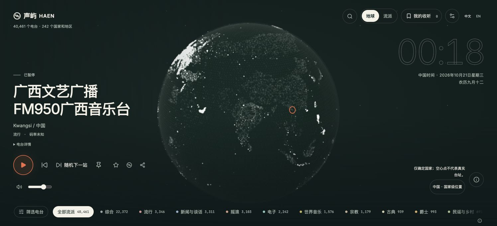
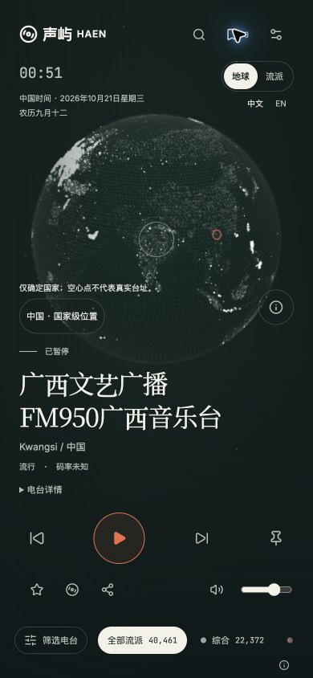

# 画面与信息层级优化

日期：2026-10-21，任务从 2026-10-20 开始。

## 需求与范围

以美观画面为目标，继续优化欢迎页、地球、播放器、顶部工具、流派条、搜索、收藏与设置面板；沿用墨绿、暖白与珊瑚橙的夜航方向，保留已有收听与探索能力。

## 实际变更

- 欢迎页增加低亮度真实地球背景，保留品牌标语，避免加载中的地图说明干扰欢迎文案。
- 地球降低大陆与海洋装饰点亮度；电台光点随画布短边调整尺寸，国家级空心点进一步减弱透明度，保留全部逐台标记、选台、缩放、键盘与省电能力。
- 地图信息按需展开，目录加载、失败与过期状态自动展示；位置精度和同地点电台入口保持直接可见。展开支持关闭、Escape、外部点击和焦点返回。
- 桌面标题改善行高，时钟与工具调整尺寸，搜索浮层靠右对齐；手机缩小长标题、均衡换行，按播放器实际高度分配地球空间，恢复地点显示。
- 顶部时间、视图和语言重新分区；手机展开搜索时隐藏同位置工具，避免遮挡。
- 流派条弱化非选中项边框与背景，当前流派保留暖白胶囊。
- 搜索、收藏、设置统一面板标题、留白、关闭目标和分组层级，确认区域与睡眠选择使用适合多行内容的圆角。

## Review 与验证

仅针对本任务差异进行 Review，覆盖响应式布局、长名称、场景材质、逐台标记、真实状态保留、折叠信息、键盘焦点与双语文案。修复了欢迎装饰场景露出加载文字、手机地图弹层关闭按钮被顶部工具遮挡，以及小画布光点叠加过亮的问题。

| 检查 | 结果 |
| --- | --- |
| 格式、ESLint、前端 TypeScript | 通过 |
| 应用、时钟、地图分组与标记单元测试 | 4 个文件、20 项通过 |
| 首批浏览器回归 | 96 项中 91 通过、5 项手机模拟因 30 秒总时限超时；单 worker 定向复验 5 项全部通过 |
| 欢迎页修正与收藏/平板补充回归 | Chromium、Firefox、WebKit、Pixel 7 模拟共 44 项通过 |
| 生产构建与资源预算 | /radio/ 构建通过，预算通过；沿用既有大分包提示 |
| 真实目录视觉核对 | Chrome 正式构建预览，桌面 1496×682、手机模拟 390×844；40,461 条公开电台目录，保持暂停 |
| 文档与差异检查 | 本地链接与 git diff --check 通过 |

浏览器自动化还覆盖 1440×900、1280×720、768×1024、320×700、844×390，检查长名称、搜索焦点、收藏、筛选、设置滚动、地图信息、错误重试、逐台标记、省电、地球/流派切换及中英可访问性。不同批次有重叠，不将用例数相加为独立场景数。

浏览器布局检查使用受控电台和音频夹具；开发预览曾通过只读本地转发查看真实目录的密集区域，未写入线上数据。浏览器模拟不代替真实设备、真实声音输出或线上发布验收。

同步后逐文件摘要一致，复审通过；四浏览器长名称与目录失败定向复验 8 项、前端类型检查及文档链接再次通过。未运行长时间压力或真实设备专项。

## 画面记录

以下为正式构建、公开真实目录的本地预览，未表示线上已更新。

欢迎与设置截图使用受控目录，仅用于布局检查：[桌面欢迎](desktop-welcome.png)、[手机欢迎](mobile-welcome.png)、[手机设置](mobile-settings.png)。

## 继续优化：手机操作与空状态

- 高度至少 600px 的手机将主要播放操作与收藏、沉浸、分享及音量分成两行，全部按钮至少 44×44px。浮层保留相应的播放操作空间；桌面与低高度横屏维持紧凑布局。
- 收藏、历史、歌曲标签使用等宽区域，名称和数量分层，完整读屏名称与数量更新保持兼容。
- 收藏、历史、歌曲和搜索空状态统一图标、标题、说明与留白；没有内容时不再显示无效的刷新、清理和复制按钮，保留导入与搜索重置。
- 中文和英文文案同步调整，移除旧的重复空状态样式。

补充 Review 核对了空清单操作边界、数量标签的完整可访问名称、搜索恢复、触控目标与浮层遮挡；修复了可见数量与读屏名称不一致、搜索展开露出底层日期、双清除图标及矩形输入焦点的问题。复制反馈保留原有 live region，仅清除空段落边距。

| 补充检查 | 结果 |
| --- | --- |
| 第一组检查 | 发现 4 项数量标签可访问性问题后停止；修复并定向复验通过 |
| 相关功能回归 | 92 项中 91 通过；Firefox 一项为 43.999984px 的浮点测量，尺寸断言按 0.01px 精度归一化 |
| 最终定向复验 | 四浏览器 36 项通过，包含中英空状态、搜索恢复、44px 按钮、键盘、沉浸与焦点 |
| 应用组件、前端类型、ESLint、格式 | 3 项组件测试及其余检查通过 |
| 最终 /radio/ 构建与预算 | 通过，沿用既有分包体积提示 |

同步后逐文件摘要一致，复审通过，前端类型、格式及文档检查通过；中英空状态与搜索焦点的四浏览器定向复验 8 项全部通过。

批次存在重叠，不合计为独立用例数量。上述检查使用可控目录、音频与手机模拟，不代替真实手机或线上验收。最终正式构建另外核对了公开真实目录下的手机播放操作、空收藏和英文搜索无结果；手机版收听截图已更新为分行操作布局。

[手机空收藏](mobile-empty-library.jpg) · [手机搜索空状态](mobile-empty-search.jpg)

## 发布范围与未完成事项

- 需更新前端静态资源，使用 radio-frontend 发布任务；本次不执行上线。
- 无需更新 radio-api、radio-jobs，无需配置调整或数据库迁移，未执行 SQL。
- 发布后的线上画面与真实手机专项仍需按发布安排验收。

返回[任务归档](../README.md)与[前端导航](../../frontend/README.md)。
