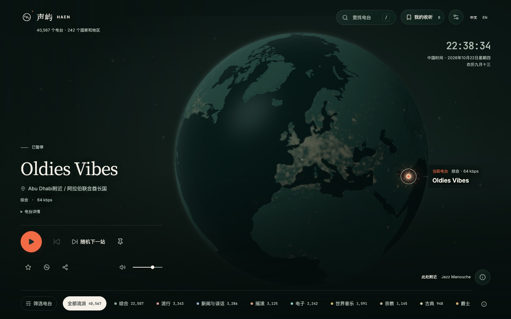

# 地球柔光分布与交互定位

日期：2026-10-22。

## 需求

用户明确要求继续优化整张地图，并指出逐个电台点与空心圈仍然影响观感。用户随后确认“连片的微光，像夜晚的城市分布”。本轮在所有缩放级别统一使用真实精确坐标生成的连续柔光分布，仅预览或选中时显示目标定位符号，沿用墨绿、灰青、暖白与珊瑚色的夜航方向。

## 实际变更

- 根据当前电台数据生成 2048×1024 单通道柔光纹理，融入球面材质。仅接受有效的精确经纬度；同一纹素内的坐标贡献合并，使用宽窄两层柔光、浮点累计和非线性压缩限制密集区域亮度。经度跨缝循环，高纬度计算考虑经度距离变化。
- 所有缩放级别都隐藏普通独立点和区域圈，持续以地表柔光作为主体；近景降低柔光亮度，保留地形细节。仅悬停、中心停留预览与当前选中位置显示目标符号：精确位置使用柔边光核，区域分组使用空心环。桌面与手机采用相同的显现规则。
- 保留原始坐标、区域分组与命中检测。省、州和国家级位置不参与柔光生成，继续通过空心分组符号和精度说明表达；不生成替代坐标。柔光是位置分布的装饰表达，不作为定量统计或真实音频能量。
- 本地陆地遮罩提高到 2048×1024，并加入同尺寸的灰度地形阴影纹理。海陆采用更明确的侧光和暗部层次，减弱海岸线与贴边亮圈，增加渐隐的大气薄光。
- 选中位置由 48 根刻度收敛为 12 根刻度，保留暖白细环与精确位置的珊瑚色状态点。区域分组不显示精确坐标光核。
- 星空保留固定分布、节点数量与播放状态动画，降低细星、十字亮星和背景雾光强度；中心大圆改为 24px 四角准星，悬停适度增强，键盘聚焦时保持清楚，装饰元素不拦截指针事件。
- 柔光纹理随电台数据更新生成，不在每帧重算。播放时仅作轻缓亮度变化；暂停、减少动态效果、省电、页面隐藏和场景不活跃时沿用停止持续绘制的规则。新增纹理和图像资源纳入引擎销毁流程。

## 地形资源

使用 Natural Earth 的公开领域 Shaded Relief Basic，完整保留 WGS 84 等距矩形范围及北向上方向，只进行缩小和灰度 JPEG 编码。资源是预先计算的地形阴影，不作为高程或位移数据。

- 输出：[relief.jpg](../../../apps/web/public/geography/relief.jpg)，2048×1024、8 位单通道灰度，187,548 字节。
- 来源与可复现加工信息：[relief-source.json](../../../apps/web/public/geography/relief-source.json)，包含官方地址、许可、源压缩包与原始栅格 SHA256、加工命令、产物 SHA256 和地理范围。
- 官网显示版本 3.2.0，下载包中的版本文件为 2.0.0，来源记录保留这一差异。
- 原始压缩包 CRC、输出尺寸与灰度通道、文件体积、哈希和完整地理范围已核验，已目视检查全球方向与地形。浏览器只读取本站资源；纹理加载失败时保留基础球面和电台操作。

## Review 与最终验证

本次实际代码、测试、资源和文档差异已自审并经独立复审，未发现未解决的功能性阻塞。复审覆盖原始坐标与拾取、精度语义、纹理更新与清空、动画停止条件、异步加载取消和资源释放。文档已区分用户确认方向与实现细节，并准确限定高纬度测试范围。

| 项目 | 结果 |
| --- | --- |
| 定向 Vitest | 4 个文件、13 项通过；覆盖柔光位置、日期线邻格对称、重复坐标、区域过滤、融合、高纬度经度距离，以及现有地理遮罩与标记语义 |
| 类型、格式与 lint | 前端 TypeScript、改动文件 Prettier 与 ESLint 通过 |
| 生产构建与资源预算 | 通过；入口 gzip 223,002 字节，总 JS gzip 549,223 字节，地理基础资源 501,882 字节，均在既有预算内 |
| 浏览器回归 | 最终代码 60 项通过，覆盖 Chromium、Firefox、WebKit、移动 Chromium；包括 3 万条目录、旋转缩放、GPU 坐标、播放居中、暂停/减少动态效果/省电/隐藏状态、星空和地形纹理成功/失败路径 |
| 像素行为检查 | 正面位置有柔光、背面不穿透；悬停显示目标、移开恢复；清空数据后无旧光层残留 |
| 真实目录截图 | Chromium 使用本地 API 的 40,567 个电台目录，检查 6 种视口、欧洲密集区和选中近景；无页面或着色器错误、无页面横向溢出 |
| 文档与差异 | 文档本地链接、目录导航及 `git diff --check` 通过 |

Vite 仍有现有大于 500 kB 分包提示；未调整提示阈值，项目资源预算检查通过。普通回归采用隔离目录和可控音源；真实目录截图不代表真实外部电台可播放性。

定向浏览器范围为 `geographic-position`、`globe-centering`、`globe-clarity`、`globe-playback`、`globe-starfield`、`globe-relief`、`globe-surface`。沿用项目 Playwright 的四种浏览器配置，本次复用已启动的本地前端与 API 服务，不重复启动服务。

## 实际截图

以下为最终实现的 Chromium 截图，均在减少动态效果下拍摄；自动回归另行检查动画与停止状态。

| 场景 | 视口 | 截图 |
| --- | --- | --- |
| 桌面初始地图 | 1440×900 | [查看](desktop.jpg) |
| 笔记本 | 1280×720 | [查看](laptop.jpg) |
| 平板 | 768×1024 | [查看](tablet.jpg) |
| 手机 | 390×844 | [查看](mobile.jpg) |
| 窄屏手机 | 320×700 | [查看](narrow.jpg) |
| 横屏手机 | 844×390 | [查看](landscape.jpg) |
| 欧洲密集分布 | 1440×900 | [查看](europe.jpg) |
| 近景与当前选中位置 | 1440×900 | [查看](closeup.jpg) |

## 发布与未完成事项

仅需通过 `radio-frontend` 更新前端静态资源，本次未发布。`radio-api`、`radio-jobs` 无需更新，无数据库迁移、环境变量或更新顺序要求。

未进行实体手机、真实外部音频与长期运行专项；多尺寸浏览器模拟不替代真机验收。

返回[任务归档](../README.md)，视觉基线见[夜航设计规范](../../frontend/design/night-voyage.md)。
