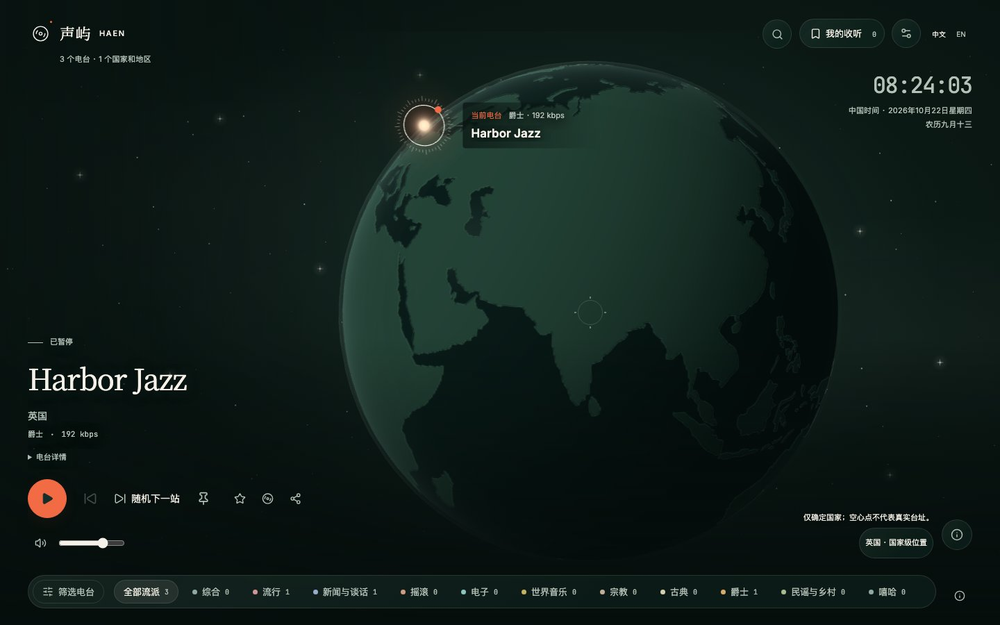
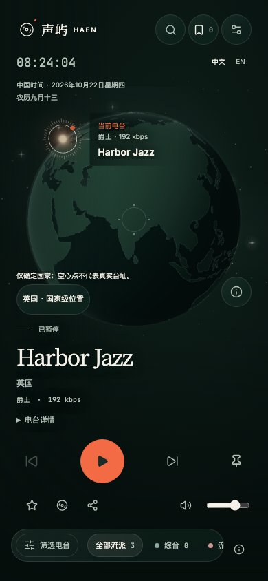

# 地球周围星空

日期：2026-10-22。

## 需求与实际变更

为地球两侧留白增加有层次的星点，保持墨绿夜航方向。新增独立 SVG 星空：210 颗大小、亮度不同的细星与 8 颗柔光亮星，位置固定，使用暖白、灰绿及低亮度雾光；顶部与底部渐隐。地球画布位于星空上方，球体自然遮住后方星点。

手机宽度小于 768px 时隐藏一半细星并降低整体亮度。星空随地球区域尺寸调整，星点自身保持像素尺寸，不按屏幕比例拉伸。不新增贴图、网络请求、依赖、WebGL 上下文或帧循环，移除原先重复平铺的微弱背景点阵。

实际播放时，亮星以 9 秒周期轻微明暗变化；暂停、减少动态效果、省电、页面隐藏或地球场景不活跃时静止。页面可见性监听在离开时移除。星空不参与鼠标、触摸、键盘焦点或辅助技术朗读。

## Review 与验证

Review 仅覆盖本次星空组件、样式、地球组件接入、旧背景点阵移除与相关浏览器回归。已检查图层遮挡、响应式密度、减少动态效果、省电和可见性条件、监听清理与交互穿透，无未解决的实现问题。

- 8 项星空专项 Playwright 检查通过，覆盖 Chromium、Firefox、WebKit 和 Pixel 7 Chromium 模拟。每个浏览器检查桌面 1440×900、笔记本 1280×720、平板 768×1024、手机 390×844、窄屏 320×700 与横屏 844×390，验证装饰层不会拦截地球操作、搜索可用、无横向溢出和页面错误。
- 浏览器实际读取动画与透明度，验证播放时缓慢变化、暂停静止、减少动态效果、省电，以及模拟页面隐藏/恢复。多浏览器并行加载时曾超过默认的 5 秒地球就绪等待，改为最多 15 秒，并串行复验通过。
- 4 项既有地球清晰度与空闲绘制检查通过，保留 3 万电台标记数、键盘缩放、DPR 上限与省电静止行为。
- 同步到播放居中版本后复审，并将该版本的引擎与更新后的取样用例叠加验证，4 项跨浏览器播放光点回归通过。旧版固定偏侧裁剪用例曾出现截图相同或超时，最终使用当前居中版本的有效取样复验；本次没有修改该引擎或取样用例。
- 前端 TypeScript、定向 ESLint/Prettier、生产构建、静态资源预算、文档链接与差异检查通过。构建保留既有大包体积建议，预算满足。复审后在固定起始提交、只叠加本次代码的独立工作副本与端口验证；六种尺寸的最终截图逐张检查。

## 截图

截图使用受控合成目录，检查星空层次与布局，不表示真实电台分布。

| 桌面 1440×900 | 手机 390×844 |
| --- | --- |
|  |  |

其他视口：[笔记本](laptop.jpg)、[平板](tablet.jpg)、[窄屏](narrow.jpg)、[横屏](landscape.jpg)。

## 发布与未完成事项

需要通过 `radio-frontend` 更新前端静态资源；本次未发布。`radio-api`、`radio-jobs` 无需更新，无数据库迁移或配置调整。未进行真机、真实外部音源或长期运行专项。

返回[任务归档](../README.md)。
