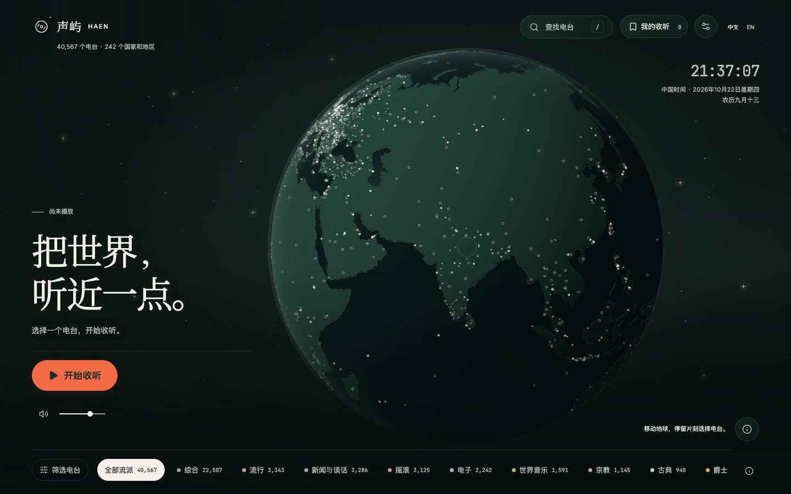
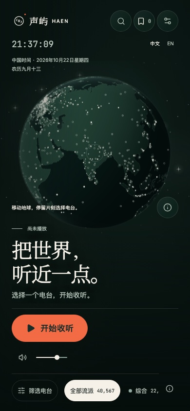

# 电台光点精修

日期：2026-10-22。

## 需求与实际变更

改善地球上电台点显得粗硬、地区空心圆过于抢眼的问题，沿用夜航配色与既有构图。

- 来源坐标点采用暖白细光核、柔和渐隐光晕与细微尺寸差异。密集区域进一步降低光晕强度，并根据画布尺寸加强小屏密度抑制，球缘逐渐减弱。
- 地区分组由大粗圈改成更小、更淡的细空心环；空心语义、地区精度说明与选中反馈保留，普通地区环不随播放闪动。
- 通过像素导数平滑边缘，基础光晕外框至少 5.8px，再随缩放与受限 DPR 调整，保证手机可见性。该尺寸不是实际光核直径，也不改变拾取半径。
- 播放时坐标点轻缓错峰闪动，明暗与尺寸变化幅度减小。继续遵守暂停、减少动态效果、省电、隐藏页面时停止持续绘制的规则。
- 点数、坐标、分组、命中检测、同地选台与资源释放保持既有逻辑。大陆与海洋装饰点保留原有材质输出；没有新增依赖、贴图、绘制批次或帧循环。

## Review 与验证

Review 仅覆盖本次点材质、响应式尺寸与文档差异。检查了坐标/数量不变、低精度空心语义、WebGL 2 导数支持、背面剔除、交互命中与资源生命周期。复审时将大陆与海洋装饰点的原有输出单独保留，避免电台样式影响地形。无未解决代码问题。

- 11 项相关 Vitest 检查通过，覆盖逐台标记、地理分组、密度计算与位置不变性。
- 前端 TypeScript、定向 ESLint/Prettier、生产构建、静态资源预算通过；构建仍有既有的大包建议，未超预算。
- 28 项 Playwright 回归通过，覆盖 Chromium、Firefox、WebKit 与 Pixel 7 Chromium 模拟：3 万电台数量、键盘缩放、DPR 与省电、前后半球遮挡、GPU 实际坐标、国家/省州分组、同地展开不移点，以及播放闪动和暂停/减少动态效果后停止绘制。
- macOS 上 Chromium 实际读取本地 API 目录，逐张检查桌面 1440×900、笔记本 1280×720、平板 768×1024、手机 390×844、窄屏 320×700、横屏 844×390，以及键盘旋转/放大画面。无横向溢出、页面异常或着色器错误。截图脚本最初等待 5 秒、随后 30 秒均短于真实目录首次加载；确认目录 69 个分块持续正常返回后，按应用既有加载期限调整等待，最终通过。没有修改数据加载实现。
- 根据第一轮截图进一步收敛了手机密集光点，复审后重跑受影响回归与截图。

## 实际截图

以下使用本地 API 当前目录，非合成电台分布；截图不代表实际音源可播放性。

| 桌面 | 手机 |
| --- | --- |
|  |  |

其他检查：[笔记本](laptop.jpg)、[平板](tablet.jpg)、[窄屏](narrow.jpg)、[横屏](landscape.jpg)、[放大](zoom.jpg)。

## 发布与未完成事项

仅需通过 `radio-frontend` 更新前端静态资源，本次未发布。`radio-api`、`radio-jobs` 无需更新，无数据库迁移、环境变量或更新顺序要求。未进行实体手机、真实外部音频与长期运行专项；本次改动不改变音频、触摸与后台机制。

返回[任务归档](../README.md)。
