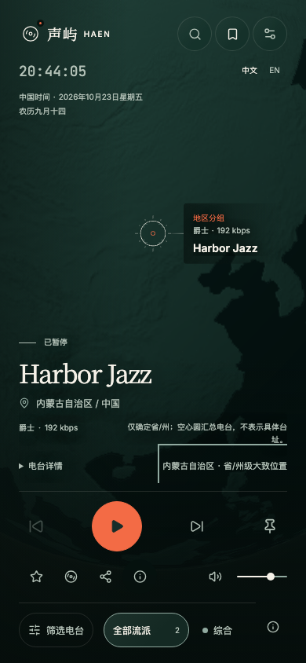
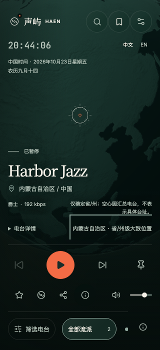
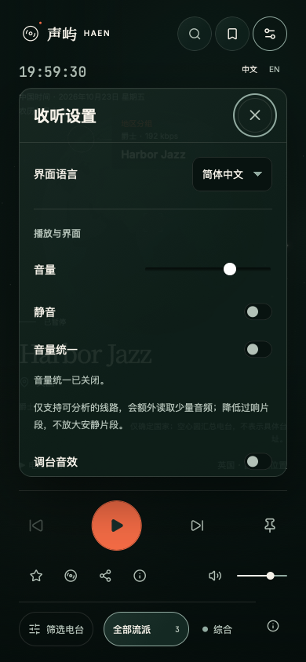

# 手机地球交互与控件配色

日期：2026-10-23。

## 需求与实际变更

- 手机国家、省/州与同坐标分组统一使用电台详情右侧的入口，省/州级不再落到地球左下。手机关闭鼠标悬停文字预览，避免拖动后出现重复地点与数量。
- 国家、省/州及未知位置的精度说明移到电台详情右侧上方，采用灰绿辅助字；保留完整说明，窄屏允许换行。桌面保持原有地图提示位置。
- 地球舞台、浮动台名、地图摘要、时钟与电台展示文字关闭文字选择和 iOS 长按菜单，画布继续使用 `touch-action: none`。输入框与展开详情保留原有操作。
- 全局键盘焦点由珊瑚橙改为灰绿，覆盖设置、搜索、收藏、帮助、筛选与地图入口；保留可见轮廓。分组按钮显式获取焦点，修复 WebKit 点击后关闭弹窗无法返回原入口的问题。
- 手机和桌面的流派选中项统一采用低亮墨绿底色、灰绿细描边与暖白文字，真实数量和选中语义继续保留。

## Review 与验证

Review 限于本轮定位入口、提示迁移、文字选择范围、焦点颜色、流派样式及对应测试；已核对断点、Portal 宿主、详情展开、焦点返回与桌面隔离。

- 77 项相关浏览器场景最终通过（初次发现的定位器与颜色采样问题修正后定向复验）；Chromium、Firefox、WebKit、Pixel 7 与 iPhone 13 模拟覆盖手机入口、精度说明位置、地图缩放、重复拖动、设置/收藏/搜索/帮助焦点、双语分组与流派切换；检查 390×844、320×700、375×667、768×1024、844×390、1440×900。Chromium 使用 CDP 触摸拖动，其余引擎使用鼠标拖动并核对防选字样式。
- 本轮页面的 axe 检查和既有焦点返回检查通过；类型检查、定向 ESLint/Prettier、32 项组件/定位单元测试、`/radio/` 生产构建、资源预算、文档链接与差异检查通过。构建保留既有大分包提示，预算仍在限制内。
- 回归时修正省级入口迁移后的旧测试定位器，并区分搜索浮层与 dialog；检查颜色时启用减少动态效果，避免采到过渡中的中间色。原全功能可访问性脚本依赖已移除的第三个收藏标签，未将该脚本作为本轮通过依据；本轮使用实际页面的定向 axe 与焦点检查。

- 同步时 GitHub、Gitee 与本地基线一致，无远端新增内容；恢复后核对全部任务文件 SHA-256，复审通过。同步后的 iPhone WebKit 7 项、类型检查、`/radio/` 构建和文档检查再次通过。

## 画面证据

使用合成目录与可控音源，未连接生产数据进行截图。

| 手机定位说明 | 窄屏 | 设置灰绿焦点 |
| --- | --- | --- |
|  |  |  |

[桌面流派选中样式](desktop-genres.png)。

## 安卓真机追加验收

- 经用户明确授权，使用已连接的安卓手机 `23127PN0CC`，Android 16、Chrome 155.0.8059.39，物理分辨率 1200×2670。通过 ADB 临时映射访问本地页面，最终复验使用 `42d1dcb` 对应的独立 `/radio/` 构建产物。
- 使用真实目录中的阿拉善蒙语综合广播，确认省/州级入口在详情同行右侧，完整精度说明在其上方；点击入口可打开分组列表并正常关闭。
- 两轮共 24 次交替拖动地球，并在地图区域、浮动文字附近、电台标题和时钟处长按；未出现文字选择或系统复制/翻译菜单，拖动仍可继续。移动后按既有规则选择中心附近电台，不将该行为当作文字选择故障。
- 真机检查设置、收藏、搜索、帮助和筛选的打开与关闭；设置关闭按钮无红圈。综合与全部流派切换保留真实选中状态，选中底色为墨绿。
- 验收期间共享开发 API 因其他进行中的模块更新短暂返回 502；恢复后重新确认 readiness、数据库和目录为正常，示例电台详情返回 200，再重新载入页面收尾。本轮未修改这些进行中的模块。
- 真机截图仅保存在本机私有归档，不纳入仓库；未记录或提交设备序列号、账号或连接凭据。临时 ADB 映射与独立预览已移除，原有开发服务保持运行。本轮未验证真实音频输出及后台播放。

## 追加：手机定位说明与流派信息紧凑排列

- 用户反馈右侧精度说明独占一行，将左侧详情推低，形成大块空白。将流派/码率与精度说明放进同一个两列网格的首行，下一行继续对齐详情与位置入口；说明不再单独占用左侧空行。
- 取消此前为独立说明额外增加的 40px 播放器上限，保持控制区和地球构图紧凑；完整精度文案、位置分组、详情展开和桌面布局保留。
- 新增间距回归：原样式在左侧多出 44px 间隔，测试先失败；修复后低于 24px。覆盖国家与省/州、中英文、320×700 / 375×667 / 390×844，补充长台名、详情展开、横屏、平板与桌面检查。
- Review 仅覆盖元信息节点移动、手机网格、提示间距、播放器上限和对应回归，未发现未解决问题。20 项 Chromium、Firefox、WebKit、Pixel 7 和 iPhone 13 模拟检查、3 项 App 单测、TypeScript、定向 ESLint/Prettier、`/radio/` 生产构建、资源预算通过。
- 安卓真机复查截图同名的俄罗斯 Radio Sova：流派/码率位于说明左侧，详情和国家入口在下一行对齐；详情展开和分组入口可用。真机截图仍只留在本机私有归档。

## 发布与限制

仅需更新前端静态资源（`radio-frontend`）；本次未部署。`radio-api`、`radio-jobs` 无需更新，无数据库迁移或配置调整。安卓真机已完成上述专项；真实 iPhone Safari 的长按菜单与连续拖动仍未验证。

返回[迭代导航](../README.md)与[设计规范](../../frontend/design/night-voyage.md)。
