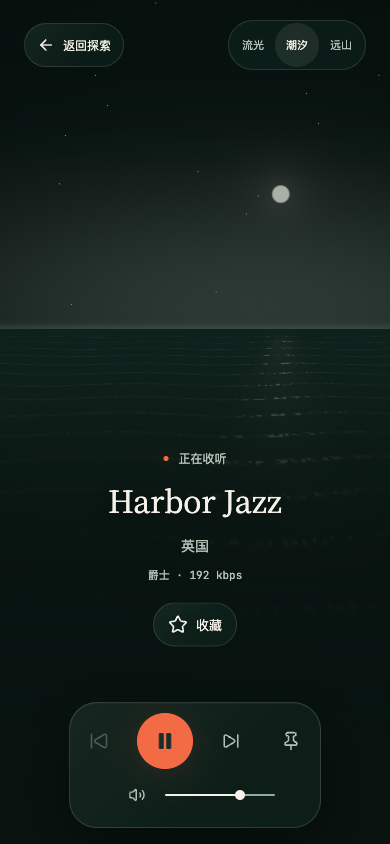
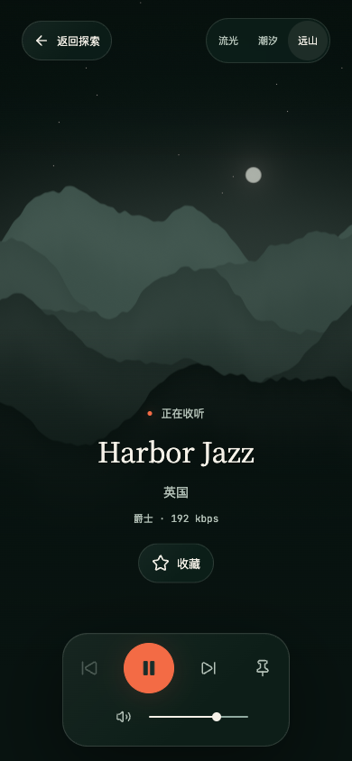

# 手机沉浸潮汐与远山美化

日期：2026-10-23。

## 需求与实际变更

改善手机「潮汐」与「远山」画面的构图、自然层次和收听信息比例，延续夜航的墨绿、灰青与暖白方向。

- 宽度小于 768px、高度至少 500px 时采用手机专用构图。潮汐加入小月轮、远处雾光、逐渐疏开的细碎水纹和月光倒影，移除手机画面中独立的同心圆。
- 远山使用适配完整屏宽的五层错落山脊、细节噪声和缓慢变化的薄雾，取消浮在山体之外的谐波线。避免直接裁切桌面场景导致山峰不完整。
- 背景继续读取主题变量；没有新图片下载、纹理请求或依赖。保留原有单平面绘制、像素上限、暂停、减少动态效果、省电、页面隐藏和资源释放机制。水纹和雾气属于装饰，不代表实时声谱。
- 静态 SVG 同步补充手机月光水面与分层山影，在无 WebGL 或上下文丢失时按断点显示对应场景。
- 调整手机标题字号、信息区留白、底部安全区和背景渐暗范围；环境切换按钮提高到 44px 触控高度。流光渲染、桌面与低高度横屏场景保持既有实现；手机共用信息布局随本次调整。
- 不改播放控制逻辑、音频会话、场景偏好或目录数据。

## Review 与验证

Review 限于本次场景着色器、静态 SVG、沉浸样式及针对性回归，检查响应式断点一致性、颜色空间、资源与事件生命周期、长内容滚动和可访问名称。针对响应式双 SVG 更新降级检查，要求当前恰好一个可见场景，未放宽播放与资源释放断言。

- 前端 TypeScript、定向 ESLint、Prettier、`/radio/` 生产构建和资源预算通过。构建保留既有大分包提示。
- 16 项 Playwright 回归通过，覆盖 Chromium、Firefox、WebKit 与 Pixel 7 浏览器模拟：三场景与双语、axe 可访问性、连续播放、暂停停绘、场景切换、省电与减少动态效果、上下文丢失/恢复、资源释放和静态降级。
- 自动布局检查覆盖 390×844、320×700、375×667、844×390、768×1024 和 1440×900，验证标题、返回、收藏与播放托盘不重叠，页面无横向溢出。人工逐轮核对手机截图并修正粗水纹、过于光滑的山脊和静态降级。
- 额外在 320×700 模拟长中英文台名、将辅助文字放大到 20px，检查标题与收藏不进入播放托盘；无 WebGL 时分别核对潮汐与远山截图。
- 静态山脊精修后，四组浏览器的无 WebGL 原用例、TypeScript 与构建复验通过。
- 同步前两个目标分支与本地一致；任务差异、归档和截图完整恢复，复审通过。同步后 15 项用例首次通过，Chromium 桌面暂停截图原断言偶发失败；同一用例独立重跑通过，未修改绘制逻辑或放宽断言。16 项用例最终均有通过结果。
- 文档链接检查通过（173 个 Markdown 文件、1219 个本地链接）。

## 手机画面

本地 Chromium，390×844，合成电台目录和可控音源，播放状态且开启减少动态效果以固定截图。截图与真实电台名称无关。

| 潮汐 | 远山 |
| --- | --- |
|  |  |

## 发布与未完成事项

仅需更新前端静态资源（`radio-frontend`），本次未部署；`radio-api`、`radio-jobs` 无需更新，无数据库迁移、配置变更或更新顺序要求。手机验证为浏览器模拟，未执行真实手机触屏、性能或音频输出专项。

返回[迭代导航](../README.md)与[设计规范](../../frontend/design/night-voyage.md)。
