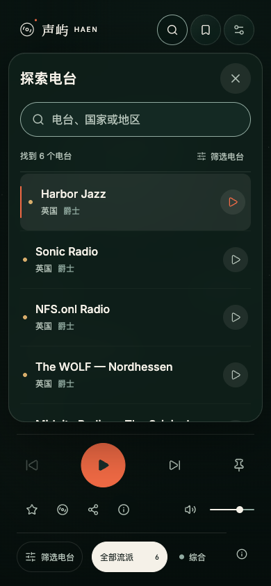
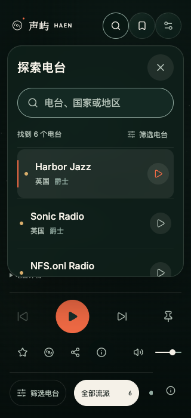
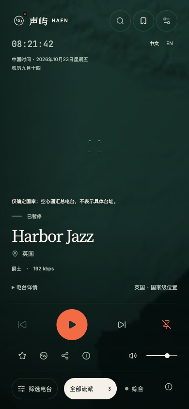

# 手机动态、地图与搜索优化

日期：2026-10-23。

## 需求与实现

本轮仅调整手机体验，桌面保持已有画面和布局。

- 潮汐：提高水纹的移动可见度，让细碎月光随水面轻晃；远山：山体保持稳定，多层雾气缓慢横移并起伏。只作用于宽度小于 768px、高度至少 500px 的既有手机构图，继续遵守播放、暂停、减少动态效果、省电与页面隐藏状态。装饰动态不代表实际声谱。
- 手机地图：画布延伸至完整视口，相机仍按原有地图舞台构图，保留按可用舞台确定的球体大小与中心。放大时球面连续延伸到顶部和透明收听区后方，消除上下硬裁切。同步校正拾取、停留选台、选中环与标签的位置换算，舞台高度变化时重新计算投影。欢迎页保持原布局。
- 手机地图信息按钮：移至分享右侧，保留唯一的按钮、44px 操作目标、展开/关闭、Escape 和焦点返回。桌面按钮仍在原地图位置。窄屏缩短音量滑轨，保留音量操作空间。
- 手机国家级位置入口：移到“电台详情”同行右侧，字号同为 11px，取消边框与底色，保留点击查看同国电台、关闭后的焦点返回；桌面入口保持原样。该入口存在时，为手机收听区补充 24px 可用高度，避免较矮视口裁切操作行。
- 手机搜索：面板两侧保留 12px 安全边距与 24px 圆角；标题和独立关闭按钮位于第一行，50px 高圆角搜索框独占第二行。列表增加有效横向空间，站名为 16px，地点与流派仍在第二行，播放提示使用低调圆形底色。保留中文输入法、清除、筛选、滚动追加、空状态和错误恢复。
- 地图、按钮与搜索样式以 768px 为分界，未改变桌面样式规则、接口、目录数据或音频会话。

## Review 与验证

Review 限于本轮样式、手机着色器、地图画布/投影、信息按钮 Portal、相关测试与文档。核对桌面投影等价、手机中心和比例不变、触屏空间、Portal 外部点击与键盘事件、媒体查询快照订阅和 ResizeObserver 清理、搜索输入与结果独立滚动。测试采样点改为实际构图舞台，避免将扩展画布的中心误当作地球中心。

- 前端 TypeScript、定向 ESLint/Prettier、App 组件 3 项测试、`/radio/` 生产构建及资源预算通过，构建保留既有大分包提示。
- 搜索与地图信息入口的 16 项跨浏览器检查通过，包含窄屏搜索框、关闭按钮、中文输入法、清除、错误恢复、信息按钮位置、开启/关闭与焦点返回。
- 暂停截图探针确认 WebGL 绘制计数保持不变；高 DPR Chromium 的合成渐变存在最大 1/255 色值舍入。暂停检查增加严格的停绘计数断言，同时允许图像通道 1 级舍入，不允许实际场景继续变化。macOS WebKit 按其原生 Option+Tab 路径验证按钮顺序。
- 地图定位、播放声波、星空、交互收起、长台名、地图信息及 axe 的 64 项跨浏览器回归通过；新增国家级入口后复验长台名、地图信息与交互收起，相关检查继续通过。
- 地图全视口缩放、信息按钮与国家级位置入口共 16 项最终检查在四组浏览器通过；覆盖 390×844、320×700/844、375×667 与中英文，并确认桌面入口恢复原位。修复了初次挂载恰逢宽度变化时的媒体查询订阅竞态，并为较矮手机补足文字入口空间。
- 手机搜索滚动追加、最后一条、筛选重置、错误重试、键盘加载与去重等 9 项回归通过，覆盖电脑、平板、手机和横屏尺寸。
- 三种沉浸场景生命周期、资源回收与降级，以及手机水面/山雾可见变化，共 12 项检查在 Chromium、Firefox、WebKit、Pixel 7 模拟下全部通过。采样排除星空、文字与控件，两秒内水面与山雾均有超过 1% 像素发生显著变化。

- 同步时 GitHub、Gitee 与本地基线一致，无远端新增变更；恢复后逐字核对任务差异与媒体哈希，复审通过。同步后手机入口/焦点及沉浸生命周期 3 项、TypeScript 和生产构建复验通过，文档链接与差异检查通过。

## 画面证据

本机 Chromium，合成目录与可控音源；截图固定减少动态效果，录像为正常播放。验证使用浏览器模拟，尚未执行真实手机性能、触屏和音频输出专项。

| 手机搜索 | 320px 窄屏搜索 | 放大地图 |
| --- | --- | --- |
|  |  |  |

国家级位置入口：[手机排列截图](mobile-country-place.png)。

实际播放录像：[潮汐水纹](mobile-ocean.webm)、[远山流雾](mobile-dunes.webm)。

## 追加：手机沉浸固定按钮

- 将小于 768px 的沉浸托盘固定按钮移至音量所在的下排，上排保留上一站、播放/暂停和下一站，播放按钮居中。固定按钮位于音量控制右侧，保留原有键盘操作。
- 使用同一个按钮与原有固定状态处理，不复制交互；44px 触控面积与睡眠计时入口保留，桌面和普通探索播放器不受影响。
- Review 范围为按钮样式类、手机沉浸网格及本文和设计规范，核对断点、隐藏元素、音量空间、键盘操作和桌面样式隔离，未发现未解决问题。
- Chromium、Firefox、WebKit 与 Pixel 7 模拟的沉浸布局、播放会话及 axe 共 8 项回归通过；覆盖 320×700、375×667、390×844、844×390、768×1024、1440×900 和英文窄屏。TypeScript、定向 ESLint/Prettier、`/radio/` 生产构建、资源预算与文档链接检查通过。仍未执行真实手机专项。
- 已检查[手机沉浸托盘截图](mobile-immersive-controls.png)，固定按钮位于音量右侧，播放按钮居中，控件未遮挡电台信息。
- 同步时两个远端与本地基线一致；恢复后核对差异与截图哈希、复审通过，手机项目的多视口布局检查再次通过。

## 发布范围

仅需发布前端静态资源（`radio-frontend`）。本次未部署；`radio-api`、`radio-jobs` 无需更新，无数据库迁移或配置调整。

返回[迭代导航](../README.md)与[设计规范](../../frontend/design/night-voyage.md)。
